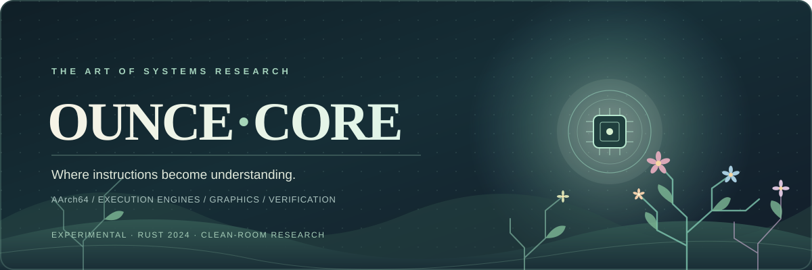
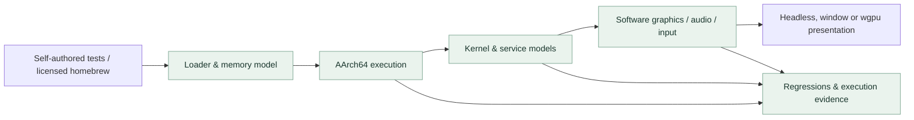

<div align="center">



<br />

[](https://github.com/hffgzktbcc-blip/ounce-core/actions/workflows/ci.yml)
[](https://www.rust-lang.org/)
[](LICENSE)
[](#what-is-verified)
[](#responsible-research)

**An inspectable AArch64 execution environment, shaped by research, built to be verified.**

[Explore the architecture](#the-system) · [Get started](#quickstart) · [See verified progress](#what-is-verified) · [Roadmap](#the-road-ahead) · [Research & provenance](#responsible-research)

</div>

---

## A different kind of computing garden

Every program is a conversation between instructions, memory, operating-system services and hardware. **Ounce-Core** is an experimental Rust research runtime that makes that conversation observable.

It brings together interpreters, tiered AArch64 execution, Horizon-style service models, software graphics and optional `wgpu` presentation. The root crate forbids unsafe Rust; the optional Tier-4 recompiler owns a separate unsafe boundary for native code generation and executable memory. The goal is to test execution behaviour systematically—not to confuse a successful build with demonstrated compatibility.

> **Long-term north star:** research the foundations needed to execute **Nintendo Switch 2** software. **Not a present capability.** Current independent experiments use **original Nintendo Switch homebrew**, and their results do not establish Switch 2 or commercial-game compatibility.

<table>
<tr>
<td width="33%" valign="top">

### 01 · Execute

Interpreter, Tier-1/2/3 optimisations and an optional Tier-4 native recompiler.

</td>
<td width="33%" valign="top">

### 02 · Model

Paged memory, scheduling, IPC, filesystem, controller, sound and graphics models.

</td>
<td width="33%" valign="top">

### 03 · Verify

Synthetic stage gates, differential tests, cross-platform CI and external-program diagnostics.

</td>
</tr>
</table>

## The system



The core is designed to remain useful as a **systems-research platform** even when a particular external program fails. A failure with a captured guest stop reason is useful diagnostic evidence—not a compatibility pass.

### The architecture at a glance

| Layer | Current capability | Important boundary |
| :--- | :--- | :--- |
| **CPU** | AArch64 interpreter, Tier-1/2/3 engines, optional Tier-4 host code generation | A subset of the architecture; external correctness is not universal |
| **Memory & kernel** | 4 KiB paging, protections, threads, events and selected SVCs | Not a cycle-accurate hardware or full OS implementation |
| **Services & file loading** | CMIF/TIPC and selected Horizon-style services; parsers for supported homebrew and synthetic formats | Incomplete service coverage; retail decryption disabled |
| **Graphics** | CPU rasterisation, selected GPU-method models, optional `wgpu` host replay | A host-rendered image is **not** a verified guest-rendered frame |
| **Sound & input** | Software audio mixing, host audio output, keyboard/gamepad mapping | Broader independent-app coverage not established |

<details>
<summary><strong>Explore the full subsystem implementation matrix</strong></summary>

### Detailed subsystem status

Status reflects what the code does and what the tests exercise. "Modelled" means the behaviour is simulated in software, not measured against hardware.

| Subsystem | Status | Notes |
| :--- | :--- | :--- |
| AArch64 CPU | Implemented (subset) | Interpreter, Tier-1 block cache, Tier-2 decoded blocks, Tier-3 fused blocks, and optional Tier-4 native recompilation in `crates/ounce-recompiler` (`native-jit`). Guest writes to translated code stop the active block and invalidate stale translations; code-patch and differential tests cover this path. |
| Memory | Implemented | 4 KB-page MMU with intra-page boundary alignment and per-page permissions. No DRAM timing model. |
| Kernel (SVC) | Implemented (subset) | Threads, events, mutexes, memory and process queries needed by the test programs. |
| IPC | Implemented (subset) | CMIF and TIPC message formats. Services are synthetic. |
| Services | Modelled | `sm:`, `set:sys` (Drake T239 model, language, nickname), `am`, `vi`, `hid`, `fsp-srv` (directory enumeration, persistent save/sdmc partitions), `pl:u` (placeholder font data), `time:u` / `time:s` (nanosecond steady clock, UTC epoch timestamp), `nvdrv`, `ro:1`. |
| GPU | Modelled; optional host-GPU replay | Selected `MAXWELL_B` and `AMPERE_B` 3D methods are decoded and rendered by a CPU rasterizer. `gpu-present` can replay supported draw output through `wgpu`. This is not a hardware driver or NVN implementation; many behaviors remain unsupported or unverified. |
| Shader translation | Partial | The older SASS path emits SPIR-V 1.5; the newer Ampere path translates a limited SASS subset through SSA IR to WGSL. The newer decoder documents unverified encodings; neither path is validated against a hardware driver. |
| Vulkan HAL (`gpu/vulkan.rs`) | Model only | Structures and SPIR-V module checks. It does not call a Vulkan loader or driver. |
| Host presentation (`gpu/present/`) | Implemented | Guest framebuffer and 3D pushbuffer geometry presented through a host GPU hardware swapchain (`wgpu`: Metal on macOS, Vulkan on Linux/Windows; feature `gpu-present`), software window (`minifb`) or headless mode. |
| Upscaler (`gpu/upscaler.rs`) | Modelled | 2× bilinear interpolation with sharpening. **Not DLSS**; there is no neural network. |
| Audio | Implemented | Software 64-voice mixer; continuous non-blocking ring-buffer streaming from `audout:u` and `audren:u` to 48 kHz stereo host audio sink via `cpal` with polyphonic resampling, underrun tracking and latency metrics. |
| Input (`hid/`) | Implemented | Controller state filled from host keyboard and physical USB/Bluetooth gamepads via `gilrs` (analog stick threshold synthesis to D-pad bitmasks). |
| Containers | Implemented (parsing) | PFS0/NSP, HFS0/XCI, NCA3, NSO0, NRO0, NPDM, RomFS, unencrypted loose directories. |
| Dynamic linking | Implemented (subset) | MOD0 `.dynamic` parsing; `R_AARCH64_RELATIVE`, `ABS64`, `GLOB_DAT`, `JUMP_SLOT`; imports resolved across modules in loose packages; `DT_REL`/`DT_RELA` tables; unresolved imports reported; `DT_GNU_HASH` symbol counts; TLS relocations (`TPREL64`, `DTPMOD64`, `DTPREL64`, `TLSDESC`) against a static TLS layout; `DT_INIT`/`INIT_ARRAY`/`FINI_ARRAY`/`DT_FINI` runner (opt-in, `OUNCE_RUN_INIT=1`). `PT_TLS` templates (`.tdata` copied, `.tbss` zeroed, `p_align` honoured) when supplied from an ELF; each `svcCreateThread` thread gets its own TLS area and `TPIDR_EL0`. Limits: NSO/NRO carry no `PT_TLS`, so for them TLS block sizes come from `STT_TLS` symbols, alignment is assumed 16, and blocks start zeroed. Guest SVCs inside initialisers are not serviced. |
| Crypto | Implemented | AES-128 checked against FIPS-197 vectors. AES-128-CTR is used for NCA sections when the user supplies keys. |

**Known limitations**

- Timing and MIPS figures are host measurements of small synthetic programs. They are not comparable to hardware and are not pass/fail criteria.
- Behaviour that is not in the test suite should be assumed unverified.

</details>

---

## What is verified

**Evidence has levels.** The checks below are meaningful, but each answers a different question.

<table>
<tr><th align="left">Verification</th><th align="left">What it tells us</th><th align="left">What it does not tell us</th></tr>
<tr><td><strong>25 harness stages / 27 checks</strong></td><td>Project-authored programs met expected functional stage gates</td><td>General homebrew or Switch 2 compatibility</td></tr>
<tr><td><strong>9 CI jobs</strong></td><td>Standard, GPU-feature and native-JIT jobs across Linux, macOS and Windows</td><td>That every engine or graphics path was tested by every job</td></tr>
<tr><td><strong>Independent homebrew probes</strong></td><td>Reports from unchanged external candidates and recorded guest failures</td><td>A correct output image or complete program support</td></tr>
<tr><td><strong>Optional feature testing</strong></td><td>Focused regressions for host GPU replay and native code generation</td><td>Hardware-exact behaviour for all guest software</td></tr>
</table>

### Development snapshot · 30 October 2026

**On `main`:** code-cache/CPU correctness work ([#93](https://github.com/hffgzktbcc-blip/ounce-core/pull/93)), bounded Binder message validation ([#91](https://github.com/hffgzktbcc-blip/ounce-core/pull/91)), external corpus preparation and diagnostics ([#89](https://github.com/hffgzktbcc-blip/ounce-core/pull/89)), and host GPU replay ordering/state corrections ([#94](https://github.com/hffgzktbcc-blip/ounce-core/pull/94)) have been merged. These do not establish independent rendered-frame correctness.

**Still under review:** [#90](https://github.com/hffgzktbcc-blip/ounce-core/pull/90) (explicit two-engine NRO runner), [#95](https://github.com/hffgzktbcc-blip/ounce-core/pull/95) (graphics startup), [#96](https://github.com/hffgzktbcc-blip/ounce-core/pull/96) (Ounce-Verify contract), [#98](https://github.com/hffgzktbcc-blip/ounce-core/pull/98) (security/coverage workflows), and [#99](https://github.com/hffgzktbcc-blip/ounce-core/pull/99) (historical provenance audit). Their branch results are **not** merged-release features.

**Release distinction:** a successful PR is not a published release. See the [Releases page](https://github.com/hffgzktbcc-blip/ounce-core/releases) for the latest packaged version, and the [open PRs](https://github.com/hffgzktbcc-blip/ounce-core/pulls) for work in progress.

<details>
<summary><strong>Full verification commands, 25-stage table and CI caveats</strong></summary>

### Detailed verification reference

```bash
cargo test --release
cargo run --release -- test
```

The harness currently reports 27 checks across 25 stages. It runs synthetic AArch64 programs written for this repository through the CPU, kernel and service models. It is not an independently authored homebrew compatibility suite. Each stage passes when its guest program returns the expected exit code; host timings are informational only. Passing this harness does not establish compatibility with commercial software or general homebrew compatibility.

CI coverage is feature-specific: the default job runs unit tests and the 25-stage harness; `gpu-present` builds and runs unit tests but does not run that harness; `native-jit` tests the recompiler crate, builds the feature, runs the Tier-4 host self-test and feature-enabled unit tests, but does not run the 25-stage harness. These configured checks describe CI coverage, not the result of the latest run. Test totals are omitted because they can change between revisions.

| Stage | Subsystem | What it checks | Exit |
| :---: | :--- | :--- | :---: |
| 01 | AArch64 ALU & branching | Fibonacci `N=10` through the block cache | `55` |
| 02 | Debug SVC | `svcOutputDebugString` with a guest string | — |
| 03 | Calling convention | Stack frame, `BL` and `RET` | `42` |
| 04 | CMIF IPC & vector math | `sm:` lookup of `nvdrv`, IEEE-754 `FADD` | `D0 = 42.0` |
| 05 | RomFS & PCM audio | Reads `romfs:/title.txt`, queues audio to `audout:u` | — |
| 06 | AES-CTR & threads | NCA section decryption, SASS-subset decode, thread spawn | — |
| 07 | Package boot & rasterizer | Boots an NSP, futex arbitration, textured triangle | — |
| 08 | crt0 & depth | `svcGetInfo`, direct-chained JIT, Z-buffer occlusion | — |
| 09 | NEON & upscaler | 128-bit vector arithmetic, 2× upscaler, save sync | — |
| 10 | FS query payload | BTI landing pad, process/thread queries, challenge response | — |
| 11 | Dynamic linker | `RO` NSO0 module over TIPC, `NS2ROEXE` reply | — |
| 12 | Thread-affinity wrapper | `BL` into a leaf that returns `0xFF`, then `AND X0, X0, #7` | `0x07` |
| 13 | Timing & events | Synthetic event init, try-wait and tick frequency | `0x124F801` (19,200,001) |
| 14 | XCI container boot | Synthetic cartridge image → HFS0 → NCA3 → NSO0 | — |
| 15 | NVN command buffer | `SVC #0x105` (research range) submission, multi-section RomFS | — |
| 16 | audren & Vulkan model | Memory pools, voice mixing, SPIR-V module construction | — |
| 17 | Service handshake | `set:sys`, `am:appletOE`, `vi:m`, `hid`, `fsp-srv` | `0x777` |
| 18 | ro:1 & texture pools | `LoadNro`, BC7 descriptor binding | `0x888` |
| 19 | SDK-style HLE runtime | Standard allocator, `SleepThread`, `nn::fs::OpenFile` | `0x999` |
| 20 | Tier-3 / optional Tier-4 | Hot-loop benchmark; select with `--cpu=tier3|tier4` (`native-jit` required for Tier-4). Host MIPS is informational, not gated. | `0xAAA` |
| 21 | Loose packages | NPDM parse, multi-module link, loose RomFS | `0xBBB` |
| 22 | Shared font & clock | `pl:u` placeholder mapping, `time:u`, ASTC 4×4 | `0xCCC` |
| 23 | Applet & GPU model | `IApplicationFunctions`, `ISelfController`, ASTC 8×8 | `0xDDD` |
| 24 | FP16 SASS & NVN ring | FP16 SASS vector math (`HADD2`, `HMUL2`, `HFMA2`), dynamic NVN buffer cycling | `0xEEE` |
| 25 | Tensor core MMA | Warp-level FP16 matrix multiply-accumulate (`HMMA.1688`, `HMMA.16816`) with FP32 accumulate, checked against IEEE binary16 vectors | `0xEEE` |

</details>

---

## Quickstart

Build from source using **Rust 1.85+ (edition 2024)** on a supported Linux, macOS or Windows host. OS-specific development libraries may be required on Linux; see the expanded setup notes below.

```bash
git clone https://github.com/hffgzktbcc-blip/ounce-core.git
cd ounce-core

# Run the self-checks
cargo test --release
cargo run --release -- test

# Explore the runtime
cargo run --release -- info
cargo run --release -- demo-dir ./demo --gui
```

**Explore optional execution and rendering paths:**

```bash
# GPU presentation via wgpu (requires supported host graphics)
cargo run --release --features gpu-present -- gfx --present=gpu

# Tier-4 native recompiler host self-test
cargo run --release --features native-jit -- jit-selftest
```

Use **self-authored, licensed or synthetic material** only. Do not supply retail keys, firmware or commercial game dumps.

<details>
<summary><strong>All command examples, dependencies and platform setup</strong></summary>

### Full getting started reference

### Prerequisites

- Rust 1.85 or newer (edition 2024).
- Host: `aarch64` or `x86_64`, Linux, macOS or Windows.
- Prebuilt Linux binaries dynamically link to the system ALSA and udev libraries. On Debian/Ubuntu: `sudo apt install libasound2 libudev1`. On Fedora: `sudo dnf install alsa-lib systemd-libs`. On Arch: `sudo pacman -S alsa-lib systemd-libs`. Building from source also needs the development headers (`libasound2-dev libudev-dev` on Debian/Ubuntu).
- GPU presentation (optional): build with `--features gpu-present`. macOS uses Metal and needs nothing extra. Windows uses Vulkan or DX12 from the installed GPU driver. Linux needs a Vulkan driver plus `libvulkan1` and `libxkbcommon-x11-0` on Debian/Ubuntu (`vulkan-loader libxkbcommon-x11` on Fedora, `vulkan-icd-loader libxkbcommon-x11` on Arch); `mesa-vulkan-drivers` gives a software Vulkan driver for machines without a GPU. If the GPU path cannot start, the runtime falls back to the software window and then to headless.

### Commands

```bash
cargo run --release -- info                      # Show modelled hardware and engine status
cargo run --release -- test                      # Run the 25-stage harness
cargo run --release -- run tests/fixtures/nro/hello/hello.nro fixture  # Boot the libnx homebrew fixture (prints result=0x00000EEE)
cargo run --release -- inspect ./dumps/title     # Inspect a user-supplied unencrypted directory
cargo run --release -- run ./dumps/title --gui   # Boot an unencrypted loose directory in a window
cargo run --release -- demo-dir ./demo --gui     # Generate a synthetic loose package and boot it
cargo run --release -- play                      # Keyboard-driven controller and graphics demo
cargo run --release -- 3d 120                    # Software rasterizer benchmark
cargo run --release --features gpu-present -- gfx --present=gpu   # Present through the GPU swapchain
cargo run --release -- gfx 60 --present=headless # No window; OUNCE_DUMP_FRAMES=<dir> writes PPM frames
cargo run --release --features native-jit -- jit-selftest # Check whether this host can execute Tier-4 code
cargo run --release --features native-jit -- test --cpu=tier4 # Run Tier-4 for the Stage 20 benchmark
```

`--present=auto|gpu|minifb|headless` (or `OUNCE_PRESENT`) picks the presentation backend; `auto` tries the GPU first when the feature is compiled in. `WGPU_BACKEND` (`vulkan`, `metal`, `dx12`, `gl`) and `WGPU_ADAPTER_NAME` select the GPU, and `OUNCE_VSYNC=0` disables vsync. `--cpu=tier3|tier4` (or `OUNCE_CPU`) selects the Stage 20 CPU engine. Tier-4 requires `--features native-jit`; the native engine is not currently used for general `run` workloads.

</details>

---

## The road ahead

*Garden principle: grow capability, measure the result, and keep the roots visible.*

| Milestone | State | Proof required |
| :--- | :--- | :--- |
| CPU code-cache invalidation | **Complete for its stated regression gate** | Synthetic write/remap tests and gated CI |
| Independent original-Switch homebrew | **In progress** | Reproducible independent inputs, guest outcomes, external reproduction and real output oracles |
| Ounce-Verify evidence layer | **Design proposed** | Implemented validator, deterministic evidence and negative tests |
| First Switch 2 vertical slice | **Blocked** | Authorised toolchain and reference hardware, self-authored sample, matched input/result/image |
| Broader target compatibility | **Future research** | Case-by-case behaviour verified against appropriate references |

The project makes **no current claim** to run Switch 2 software, retail titles or arbitrary homebrew. See [independent corpus methodology](docs/independent-corpus.md) and the [proposed Ounce-Verify design](https://github.com/hffgzktbcc-blip/ounce-core/pull/96).

---

## Responsible research

> [!IMPORTANT]
> Ounce-Core is **unaffiliated** with Nintendo, NVIDIA or their affiliates. Nintendo Switch, Switch 2, NVIDIA, Tegra, Horizon and related names are used descriptively and remain the respective owners' trademarks. This project is an experimental research implementation—not a commercial game compatibility product.

- **No distributed retail keys, firmware, game dumps or commercial assets.** Retail decryption is disabled by project policy.
- **Current tree is not the whole history.** Previously identified third-party/firmware-derived historical material remains subject to the documented provenance audit; a public Git-history purge is **not** complete.
- **Fixture origins still need review.** Some bundled homebrew fixture authorship and binary composition are not yet independently verified.
- **Licensing:** project source is [MIT-licensed](LICENSE), with [third-party notices](THIRD_PARTY.md). This does not certify the status of every historical or binary component.

Read [the provenance register](docs/PROVENANCE.md), [clean-room protocol](docs/CLEAN_ROOM.md), [historical remediation plan (draft)](https://github.com/hffgzktbcc-blip/ounce-core/pull/99), and [contribution guidelines](CONTRIBUTING.md) before contributing.

<details>
<summary><strong>Full legal notice, security advisory and current known issues</strong></summary>

### Full legal notice

**What this repository does not contain**

- No firmware, system archives, or code or data derived from them.
- No encryption keys. The loader decrypts only containers built with the in-repo synthetic test key; retail keys are rejected (`LoadError::RestrictedCipher`). A `prod.keys`-format parser exists for unit tests of the key-file format only. The `.gitignore` excludes key files.
- No retail game content, ROMs, or dumps. Tests include generated synthetic programs and checked-in homebrew NRO fixtures. The `hello` fixture build links libnx and uses the devkitA64/newlib toolchain; see [`tests/fixtures/nro/hello/README.md`](tests/fixtures/nro/hello/README.md). Fixture source comparisons and binary component inventories are incomplete; see [`docs/PROVENANCE.md`](docs/PROVENANCE.md) and [`THIRD_PARTY.md`](THIRD_PARTY.md).
- Earlier revisions contained firmware-derived and third-party-derived byte sequences; they were removed from the current tree but remain in git history. See *Known Issues*.

**Trademarks.** "Nintendo", "Nintendo Switch", "Switch 2", "NVIDIA", "Tegra", "Horizon" and related names are trademarks of their respective owners. This project is not affiliated with, endorsed by, or sponsored by any of them. Names appear only to describe the hardware and ABI being modelled.

**No warranty; not legal advice.** The software is provided as is. Anyone using, modifying or distributing it is responsible for complying with the copyright, anti-circumvention and other laws that apply where they are. Consult a lawyer before any use beyond private research.

**License information.** The repository includes an MIT license ([`LICENSE`](LICENSE)) and third-party material notes ([`THIRD_PARTY.md`](THIRD_PARTY.md)). These documents do not determine the licensing status of historical commits or every component in the checked-in binaries.

### Security advisory

> [!WARNING]
> Third parties may distribute executables labelled "ounce-core" that contain malware. The only source of this project is the repository above. Build from source with the standard Rust toolchain.

### Known issues

- **Git history.** A history cleanup has been discussed; completion is not verified. The project has previously identified commits before `76ce766` (including `c7f16f2` and `4be9640`) as containing firmware-derived or third-party-derived byte sequences and an external-payload loader. On 2026-10-28, this checkout confirmed `c7f16f2` is reachable from `main`, tags `v0.3.0` through `v0.3.2`, and the fetched pull-request refs `72`, `81`, `82`, and `83`. This is a dated, limited ref check, not an inventory of every branch, tag, fork, clone, or GitHub ref. See [`docs/PROVENANCE.md`](docs/PROVENANCE.md).
- **Commercial container decryption.** Decryption in `loader/nca.rs` is restricted by policy to synthetic test vectors (`SYNTHETIC_TEST_KEY`). Retail key decryption is disabled; research binaries must be supplied as unencrypted loose directories or homebrew packages.
- **Provenance status.** The provenance register and clean-room protocol are drafts and have not been legally reviewed. Known source comparisons and binary composition checks remain incomplete: [`docs/PROVENANCE.md`](docs/PROVENANCE.md), [`docs/CLEAN_ROOM.md`](docs/CLEAN_ROOM.md).

</details>

---

## Contributing

Thoughtful additions are welcome: synthetic instruction regressions, source-provenanced homebrew tests, documented behaviours, measured performance and reproducible verification.

Follow [CONTRIBUTING.md](CONTRIBUTING.md), [AGENTS.md](AGENTS.md) and [the clean-room rules](docs/CLEAN_ROOM.md). Contributors must not add prohibited material, silently replace unknowns with invented success, or bypass required CI. The `src` runtime forbids unsafe Rust; optional native-code support has a separately identified boundary.

<details>
<summary><strong>Repository layout</strong></summary>

### Repository layout

```
ounce-core/
├── .github/workflows/ # Cross-platform CI
├── assets/            # Vector artwork
├── crates/
│   └── ounce-recompiler/ # Optional Tier-4 native code and executable-memory boundary
├── docs/design/       # Architecture and implementation notes
├── src/               # Runtime, CPU, GPU, kernel, loader and host integrations
├── tests/fixtures/nro/ # Checked-in homebrew integration fixtures
├── AGENTS.md
├── Cargo.lock
├── Cargo.toml
├── CONTRIBUTING.md
├── LICENSE
└── README.md
```

</details>

<div align="center">

---

**Built for curiosity. Grounded in evidence.**

<sub>Ounce-Core · experimental systems research · maintained in the open</sub>

</div>
