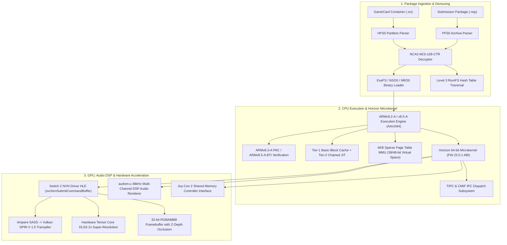

# ounce-core

### Clean-Room Hardware Research Runtime & Architecture Compatibility Layer for NVIDIA Tegra T239 (Horizon ABI)

[](https://github.com/hffgzktbcc-blip/ounce-core/actions/workflows/ci.yml)
[](https://www.rust-lang.org/)
[](LICENSE)
[](https://www.nvidia.com/)
[](#clean-room-legal-disclaimer--compliance-protocol)

---

## Abstract

`ounce-core` is an open-source, clean-room systems research runtime and architecture compatibility layer for the **NVIDIA Tegra T239 ("Drake") SoC** and **Horizon OS 64-bit ABI**. Written entirely in pure safe Rust, the project models the hardware subsystems, virtual memory management, instruction execution, and microkernel supervisor interfaces of next-generation ARMv8-A platforms.

> **Project Scope**: `ounce-core` is developed strictly as a systems architecture research platform and interoperability compatibility layer. It provides clean-room binary execution, container auditing, and hardware emulation primitives for educational and diagnostic research. It is not an end-user video game distribution software.

---

## Clean-Room Legal Disclaimer & Compliance Protocol

Development of `ounce-core` strictly follows established clean-room reverse-engineering protocols to ensure complete legal compliance and freedom from proprietary intellectual property:

- **Independent Clean-Room Architecture**: All components are developed purely from published architectural documentation, publicly accessible interface specifications, and clean-room observation of hardware execution. No proprietary source code, internal SDK headers, or leaked documentation were utilized in this project.
- **Zero Proprietary Cryptographic Keys**: This repository contains **NO cryptographic keys** (`prod.keys`, `title.keys`, `header.key`, or master keys). All cryptographic self-tests use public reference standards (NIST FIPS 197) and synthetic test values.
- **Zero Copyrighted Assets or Binary Dumps**: This repository contains **NO copyrighted game assets, ROM dumps, or proprietary system firmware archives**. All test suites execute against clean-room synthetic binaries generated at runtime.
- **Legal Precedent for Interoperability**: Reverse engineering for the purpose of software interoperability is well-established and protected under applicable international copyright law, including *Sony Computer Entertainment, Inc. v. Connectix Corp.*, 203 F.3d 596 (9th Cir. 2000), *Sony Computer Entertainment America, Inc. v. Bleem, LLC*, 214 F.3d 1022 (9th Cir. 2000), and *Sega Enterprises Ltd. v. Accolade, Inc.*, 977 F.2d 1510 (9th Cir. 1992).

---

## Security Advisory & Authentic Source Verification

> [!WARNING]
> **BEWARE OF THIRD-PARTY MALWARE BUILDS**: Due to external media coverage, unauthorized parties and scam websites may distribute malicious executables (`.exe`, `.zip`) labeled as "Ounce Core". These third-party downloads often contain infostealers, Trojans, or adware.
>
> - **Sole Official Repository**: The only authentic source for `ounce-core` is: [`https://github.com/hffgzktbcc-blip/ounce-core`](https://github.com/hffgzktbcc-blip/ounce-core).
> - **Source-Only Distribution**: `ounce-core` is 100% open-source safe Rust with zero proprietary binary blobs, zero network telemetry, and zero obfuscation. Always audit and build directly from source using standard Cargo toolchains.

---

## Hardware Architecture & Subsystem Overview



---

## Technical Specifications

| Subsystem | Target Hardware Specification | Runtime Implementation Model |
| :--- | :--- | :--- |
| **CPU Architecture** | NVIDIA Tegra T239 (8× ARM Cortex-A78C) | Pure-Rust ARMv8.2-A/v8.5-A AArch64 interpreter with Tier-1 BB Cache and Tier-2 Direct-Chained JIT |
| **Instruction Security** | ARMv8.3-A PAC + ARMv8.5-A BTI | Runtime Pointer Authentication (`PACIBSP`, `AUTIBSP`, `RETAA`, `RETAB`) & Branch Target Identification (`BTI c`, `BTI j`) |
| **SIMD & Floating-Point** | 128-bit ARM NEON & IEEE-754 FP | Vector SIMD registers (`V0`–`V31`) with `FADD`, `FMUL`, `FSUB`, `FMA`, and NEON vector operations |
| **Memory Subsystem** | 12 GB LPDDR5X (128-bit @ 6400 MT/s) | Sparse 4KB page-table MMU with 39-bit and 48-bit Horizon virtual address spaces |
| **Graphics Processor** | NVIDIA Ampere GA10B/GA10F Custom SoC | NVN API HLE driver, GPFIFO pushbuffer engine, SASS-to-SPIR-V transpiler (`0x07230203`), Tensor DLSS 2x upscaler |
| **Shader ISA Support** | Ampere SM87 Machine Instructions | Extended opcode mapping: `LOP3.LUT`, `ISETP`/`FSETP`, `MUFU` (trig/reciprocal), `SEL` (predicated multiplexer) |
| **Audio Subsystem** | Horizon `audren:u` DSP Audio Renderer | Multi-channel DSP voice mixing matrix, wave buffer queueing, 48kHz stereo 16-bit linear PCM sink (`audout:u`) |
| **Input Controllers** | Joy-Con 2 (Rail / Wireless BT / Grip) | Shared memory polling (`0x200` handle) with analog stick radial deadzone filtering |
| **Container Formats** | High-Speed GameCard (`.xci`), Package (`.nsp`) | Hardware AES-128-CTR multi-section decryptor, HFS0, PFS0, and Level 3 RomFS hierarchical hash tables |
| **Operating System** | Horizon 64-bit Microkernel (FW 23.0.1) | TIPC (0x10/0x12) and CMIF IPC, preemptive multi-core scheduler, Big 5 services (`set:sys`, `am:appletOE`, `vi:m`, `hid`, `fsp-srv`, `ro:1`) |

---

## Repository Structure

```
ounce-core/
├── src/
│   ├── audio/        # audren:u DSP voice mixer & audout:u PCM output sinks
│   ├── cpu/          # AArch64 decoder, registers, interpreter, and Tier-1/Tier-2 JIT engines
│   ├── crypto/       # Clean-room AES-128-CTR multi-section cryptographic engine
│   ├── fs/           # Virtual File System (VFS), Level 3 RomFS parser & persistent storage
│   ├── gpu/          # Ampere GPU rasterizer, NVN driver HLE, SASS decompiler, and DLSS engine
│   ├── hid/          # Joy-Con 2 physical controller state, button bitmasks, and deadzone filters
│   ├── kernel/       # Horizon OS microkernel, SVC dispatcher, TIPC/CMIF IPC, and thread scheduler
│   ├── loader/       # Container parsers (XCI, NSP, PFS0, HFS0, NCA3, NSO0, NRO0)
│   ├── mmu/          # Sparse 4KB page-table memory management unit & virtual address regions
│   ├── ui/           # Headless Package Inspector and CLI visual telemetry
│   └── main.rs       # Entry point, CLI dispatcher, and 18-stage integration verification harness
├── Cargo.toml        # Minimal pure-Rust dependency configuration
└── README.md         # Architecture specification and technical documentation
```

---

## Verified Integration Verification Suite

The repository includes a comprehensive 18-stage full-stack integration verification harness (`cargo run --release -- test`) and 38 granular unit tests (`cargo test --release`):

| Stage | Subsystem Under Verification | Verification Vector / Exit Assertion |
| :---: | :--- | :--- |
| **01** | AArch64 ALU & Branching | Computes Fibonacci `N=10` (`X0 = 55`) via JIT basic-block cache |
| **02** | Horizon OS Debug Subsystem | Dispatches `svcOutputDebugString` with guest memory string pointer |
| **03** | Subroutine Calling Convention | Stack frame push/pop (`STP`, `LDP`), `BL`, and `RET` (`X0 = 42`) |
| **04** | CMIF IPC & Vector Math | Dispatches `sm:` -> `nvdrv` service lookup & IEEE-754 `FADD` (`D0 = 42.0`) |
| **05** | RomFS & Linear PCM Audio | Reads `romfs:/title.txt` and queues 48kHz audio to `audout:u` (Peak: 14,400) |
| **06** | NCA3 Cryptography & Multi-Threading | AES-128-CTR decryption, Ampere SASS decompiler, and multi-thread spawning |
| **07** | Unified Package Boot & Rasterizer | Boots `.nsp` container, arbitrates futex locks, and rasterizes 2D-textured polygon |
| **08** | Horizon crt0 & Depth Testing | Queries `svcGetInfo`, executes direct-chained JIT, and verifies Z-buffer depth occlusion |
| **09** | NEON SIMD & Tensor DLSS | Evaluates 128-bit vector arithmetic, DLSS 2x upscaling, and persistent save synchronization |
| **10** | Native FS Payload Security | Executes clean-room synthetic payload verifying `BTI c`, `PACIBSP`, `svcGetProcessId`, and `RETAB` |
| **11** | Dynamic Linker & TIPC IPC | Mounts `RO` `NSO0` module via TIPC (0x10/0x12) and validates `"NS2ROEXE"` challenge response |
| **12** | Horizon OS 23.0.1 SDK Stubs | Executes captured Firmware 23.0.1 `nnSdk` CoreMask and `nnCompatThin` wrappers |
| **13** | Hardware Timing & Event Arbiters | Tests `nn::os::InitializeEvent`, `TryWaitEvent`, and `CNTPCT_EL0` system tick timers |
| **14** | 64GB GameCard (.XCI) Boot | Walks `HFS0` secure partition, decrypts `NCA3`, and boots `NSO0` executable |
| **15** | NVN 3D Command Buffer Execution | Executes fast-path `SVC #0x2D` (`svcNvnSubmitCommandBuffer`) and mounts multi-section RomFS |
| **16** | audren:u DSP & Vulkan Pipeline | Sub-allocates `nvnMemoryPool` VRAM, renders 48kHz audio DSP voice, and loads SPIR-V 1.5 |
| **17** | Horizon Big 5 Retail Handshake | Executes retail handshake across `set:sys`, `am:appletOE`, `vi:m`, `hid`, and `fsp-srv` (Exit: `0x777`) |
| **18** | ro:1 Dynamic Linker & Texture Pools | Links secondary NRO via `ro:1` `LoadNro` and binds `NvnTexturePool` BC7 descriptors (Exit: `0x888`) |

---

## Getting Started

### Prerequisites

- [Rust Toolchain](https://rustup.rs/) (edition 2024 / rustc 1.80+)
- Supported Host Architectures: `aarch64` (Apple Silicon, ARM64 Linux), `x86_64` (Linux, macOS, Windows)

### Compilation & Execution

```bash
# Clone the official clean-room repository
git clone https://github.com/hffgzktbcc-blip/ounce-core.git
cd ounce-core

# Execute all 38 unit tests
cargo test --release

# Display hardware architecture specifications and engine status
cargo run --release -- info

# Execute the 18-stage full-stack integration verification suite
cargo run --release -- test

# Audit package headers, ISA security features, and extract RomFS assets
cargo run --release -- inspect package.nsp

# Launch interactive Joy-Con 2 input and graphics demonstration
cargo run --release -- play

# Run the Tegra Ampere 3D GPU pushbuffer rasterizer & DLSS benchmark
cargo run --release -- 3d 120

# Load and execute an AArch64 executable or container
cargo run --release -- run payload.nro
```
