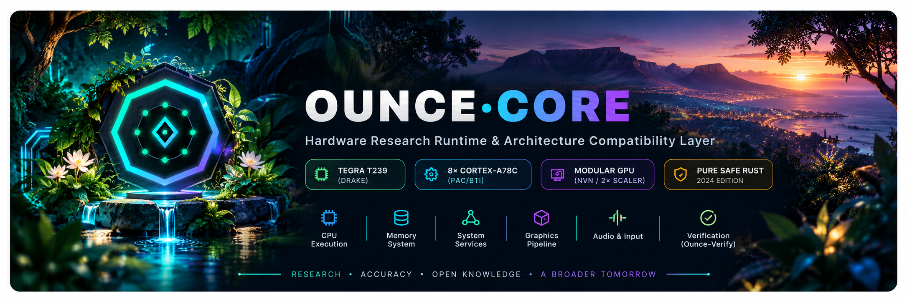
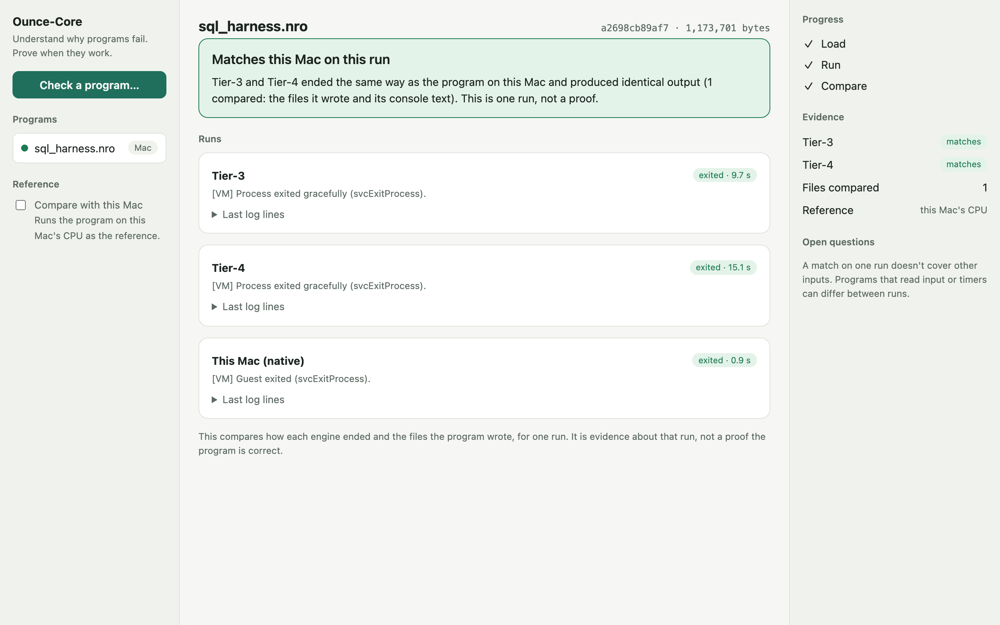
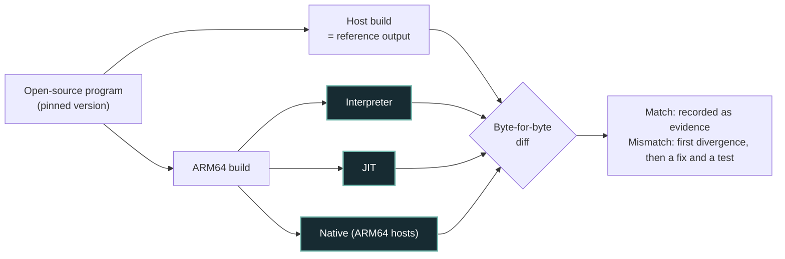

<div align="center">



<br />

[](https://github.com/hffgzktbcc-blip/ounce-core/actions/workflows/ci.yml)
[](#what-is-proven)
[-cc754f?style=flat-square&logo=rust&logoColor=white)](#safe-rust-by-construction)
[](https://www.rust-lang.org/)
[](LICENSE)
[](#what-is-proven)
[](#responsible-research)

# Ounce-Core

**Understand why programs fail. Prove when they work.**

An open-source ARM64 execution, debugging and verification platform in safe Rust.

[Vision](docs/VISION.md) · [Research paper](site/research.html) · [Browser playground](docs/PLAYGROUND.md) · [Interactive lab](docs/INTERACTIVE_LAB.md) · [How it works](#the-system) · [Get started](#quickstart) · [What is proven](#what-is-proven) · [Reproduce it](docs/REPRODUCE.md) · [Limits](docs/LIMITS.md) · [Add a program](docs/ADD_A_PROGRAM.md) · [Roadmap](#the-road-ahead) · [Contribute](site/contribute.html) · [First issues](https://github.com/hffgzktbcc-blip/ounce-core/contribute)


<br />



<sub>The workbench (`ounce-core ui`) checking SQLite on three engines against this Mac. A match is evidence for one run, not a proof.</sub>

<sub>Came here for the Switch emulator? [What changed and why](https://github.com/hffgzktbcc-blip/ounce-core/discussions/330).</sub>

</div>

---

> [!TIP]
> **Have an Apple Silicon Mac, Raspberry Pi, or ARM64 Linux VM?**
> Help verify our AArch64 differential test suite in two minutes:
> ```bash
> git clone https://github.com/hffgzktbcc-blip/ounce-core && cd ounce-core
> cargo build --release
> python3 scripts/verify_differential.py --json my-results.json
> ```
> Report your run in **[Issue #248](https://github.com/hffgzktbcc-blip/ounce-core/issues/248)** using the [External Test Report Template](docs/community/EXTERNAL_TEST_REPORT.md) to have your hardware recorded in our verification ledger!

<a id="the-ounce-vision"></a>

## What it is

Ounce-Core is an AArch64 (ARM64) execution lab written in safe Rust. It runs programs on three CPU engines (an interpreter, a JIT, and native execution on ARM64 hosts) and compares what they compute against a reference build on real ARM64 hardware. When they disagree it tells you where.

It began as a Nintendo Switch homebrew runtime. That is no longer the goal; see [the vision](docs/VISION.md). What it proved good at is finding emulation bugs quickly. In one week, running unmodified open-source programs and diffing them against an Apple Silicon host found a prefetch instruction silently corrupting registers, two floating-point instructions with the wrong sign (so `sin`, `cos` and `pow` returned wrong values), and a long list of missing vector instructions.

**Three pillars** (each with an honest maturity label; see [the vision](docs/VISION.md#maturity-labels))

- **Ounce-Verify: prove correctness.** Compare engines and a real-hardware reference, detect discrepancies, keep hashes and reports. *Most mature.*
- **Ounce-Debug: understand failures.** Reproduce a problem, compare results, find where behaviour first diverges. *Demonstrated for one bounded workflow.*
- **Ounce-Learn: make computing understandable.** Study ARM64 execution one instruction at a time in the [real WebAssembly playground](docs/PLAYGROUND.md). *Bounded Chromium execution verified.*

**Who it is for:** library maintainers who want to know whether their code behaves the same on ARM64 as on x86 without owning ARM hardware; emulator and JIT authors; educators; researchers.

Verification is the product. It is not a fast emulator and does not promise to run everything: running arbitrary ARM64 or Linux applications and automatic root-cause finding are **not established**. Coverage is partial; QC is modelled for implemented saturating instructions, while FPCR behavior and cumulative FP exception flags remain unmodelled. The [roadmap](docs/VISION.md#roadmap-each-step-is-one-small-checkable-result) starts with an outside developer solving a real problem, then running ordinary static Linux ARM64 programs so no console SDK is needed.



---

## The system

The runtime loads an ARM64 program, models memory, system calls and services, and executes it on one of three engines. Everything on the evidence path is checked against a reference rather than asserted. The Switch-era loader, kernel, GPU and audio models are still in the tree and tested; they are how the first programs got loaded and are now a regression corpus, not the product direction.

### The architecture at a glance

<!-- BEGIN GENERATED ARCHITECTURE: scripts/render_roadmap.py -->
Implemented code paths are not universal compatibility proof. Source links identify implementation, not certification.

| Layer | Current implementation | Important boundary | Source |
| :--- | :--- | :--- | :--- |
| **CPU execution** | AArch64 interpreter, cached/decoded/fused block paths (Tier 1–3), optional Tier-4 native JIT and AArch64-host native execution | Instruction coverage is partial; Tier-4 and native execution are separate from the Interpreter/Tier-3 headline oracle count. | [interpreter.rs](src/cpu/interpreter.rs), [tier3_jit.rs](src/cpu/tier3_jit.rs) |
| **Memory and kernel** | 4 KiB paged guest memory, access permissions, thread scheduling, synchronization and selected SVCs | Horizon-style subsets, not complete OS semantics, hardware timing or a security sandbox. | [memory.rs](src/mmu/memory.rs), [scheduler.rs](src/kernel/scheduler.rs) |
| **Services and loading** | Selected CMIF/TIPC service models; NRO/NSO and package parsing; homebrew and synthetic execution paths | Incomplete service coverage; retail decryption remains restricted; parsing a container does not demonstrate execution. | [cmif.rs](src/kernel/cmif.rs), [hipc.rs](src/kernel/hipc.rs) |
| **Graphics and presentation** | Guest-frame capture, software rasterization, and experimental guest SASS execution through wgpu with render-target readback | Physical GPU execution and unchanged outside-frame oracles have separate qualification gates. | [host.rs](src/gpu/ampere/host.rs), [render.rs](src/gpu/ampere/render.rs) |
| **Audio and input** | Software audio mixing with CPAL host output; keyboard/gamepad mapping and selected HID service paths | Host device support varies by platform; external-program correctness needs case-specific tests. | [host.rs](src/audio/host.rs), [audren.rs](src/audio/audren.rs) |
| **Execution evidence** | Ounce-Verify records, first-frame oracles, artifact-integrity checks, corpus comparison, diagnosis, retries, bisection and resumable runs | Passing local unit tests or CI does not certify general compatibility, provenance or an independent rerun. | [ounce_verify.py](tools/ounce_verify.py), [corpus_verify.py](scripts/corpus_verify.py) |

<!-- END GENERATED ARCHITECTURE -->

<details>
<summary><strong>Explore the full subsystem implementation matrix</strong></summary>

### Detailed subsystem status

Status reflects what the code does and what the tests exercise. "Modelled" means the behaviour is simulated in software, not measured against hardware.

| Subsystem | Status | Notes |
| :--- | :--- | :--- |
| AArch64 CPU | Implemented (subset) | Interpreter, Tier-1 block cache, Tier-2 decoded blocks, Tier-3 fused blocks, and optional Tier-4 native recompilation in `crates/ounce-recompiler` (`native-jit`). Guest writes to translated code stop the active block and invalidate stale translations; code-patch and differential tests cover this path. |
| Memory | Implemented | 4 KB-page MMU with intra-page boundary alignment and per-page permissions. No DRAM timing model. |
| Kernel (SVC) | Implemented (subset) | Threads, events, mutexes, memory and process queries needed by the test programs. |
| IPC | Implemented (subset) | CMIF and TIPC message formats. Services are synthetic. |
| Services | Modelled | `sm:`, `set:sys` (Drake T239 model, language, nickname), `am`, `vi`, `hid`, `fsp-srv` (directory enumeration, persistent save/sdmc partitions), `pl:u` (placeholder font data), `time:u` / `time:s` (nanosecond steady clock, UTC epoch timestamp), `nvdrv`, `ro:1`. |
| GPU | CPU execution; experimental host execution | Selected `MAXWELL_B` and `AMPERE_B` methods execute in the guest channel path. With `gpu-present` and `OUNCE_GPU_BACKEND=host`, supported guest SASS is translated to WGSL, submitted through a real host graphics API, and read back into the original guest surface. Adapter identity and completed readbacks are recorded; software adapters never count as hardware. [Scope and qualification](docs/guest-host-gpu.md). |
| Shader translation | Partial | Maxwell/Ampere SASS lowers through SSA IR to WGSL; the experimental host path validates and submits supported shaders through wgpu. Indexed uniforms require actual guest binding sizes. Tegra encoding and shader-behavior coverage remain incomplete; the older SPIR-V emitter is a fixture. |
| Legacy pipeline fixture (`gpu/vulkan.rs`) | Bookkeeping only | Header checks and records; no device, driver calls or hardware presentation. Actual guest host execution lives in `gpu/ampere/host.rs`. |
| Host presentation (`gpu/present/`) | Implemented | Guest framebuffer and supported draw output presented through a host swapchain (`wgpu`: Metal on macOS, Vulkan on Linux/Windows; feature `gpu-present`), software window (`minifb`) or headless mode. A wgpu adapter may itself be software. |
| Upscaler (`gpu/upscaler.rs`) | Modelled | 2× bilinear interpolation with sharpening. **Not DLSS**; there is no neural network. |
| Audio | Implemented | Software 64-voice mixer; continuous non-blocking ring-buffer streaming from `audout:u` and `audren:u` to 48 kHz stereo host audio sink via `cpal` with polyphonic resampling, underrun tracking and latency metrics. |
| Input (`hid/`) | Implemented | Controller state filled from host keyboard and physical USB/Bluetooth gamepads via `gilrs` (analog stick threshold synthesis to D-pad bitmasks). |
| Containers | Implemented (parsing) | PFS0/NSP, HFS0/XCI, NCA3, NSO0, NRO0, NPDM, RomFS, unencrypted loose directories. |
| Dynamic linking | Implemented (subset) | MOD0 `.dynamic` parsing; `R_AARCH64_RELATIVE`, `ABS64`, `GLOB_DAT`, `JUMP_SLOT`; imports resolved across modules in loose packages; `DT_REL`/`DT_RELA` tables; unresolved imports reported; `DT_GNU_HASH` symbol counts; TLS relocations (`TPREL64`, `DTPMOD64`, `DTPREL64`, `TLSDESC`) against a static TLS layout; `DT_INIT`/`INIT_ARRAY`/`FINI_ARRAY`/`DT_FINI` runner (opt-in, `OUNCE_RUN_INIT=1`). `PT_TLS` templates (`.tdata` copied, `.tbss` zeroed, `p_align` honoured) when supplied from an ELF; each `svcCreateThread` thread gets its own TLS area and `TPIDR_EL0`. Limits: NSO/NRO carry no `PT_TLS`, so for them TLS block sizes come from `STT_TLS` symbols, alignment is assumed 16, and blocks start zeroed. Guest SVCs inside initialisers are not serviced. |
| Crypto | Implemented, tested | AES-128 tested against FIPS-197 vectors. Decryption works only with the in-repo synthetic test key; retail keys are rejected (`RestrictedCipher`). ounce-core accepts only already-decrypted inputs. |

**Known limitations**

- Timing and MIPS figures are host measurements of small synthetic programs. They are not comparable to hardware and are not pass/fail criteria.
- Behaviour not exercised by an outside program's pixel oracle is tested at best, not proven.

</details>

---

## What is proven

**Differential tests against real ARM64 hardware** (each folder in [docs/verify](docs/verify/README.md) holds the sources of its test, the pinned program version, the host reference output and the per-engine result): LZ4, xxHash, SQLite 3.50.4, Lua 5.4.7, and a 5,964-line floating-point instruction test. On Tier-3, Tier-4 and native, output is byte-identical to the host reference. Native execution runs on the host CPU, so Tier-3 and Tier-4 are the real evidence. Additional harnesses (zlib, cJSON, TinyExpr, Monocypher and wasm3) are included in the [differential manifest](docs/verify/differential.json); see their per-harness results and limits. Each shows agreement on the inputs tested, not that the program or the emulator is correct everywhere. To rerun them on your own ARM64 machine see [docs/REPRODUCE.md](docs/REPRODUCE.md); for what they do not show, see [docs/LIMITS.md](docs/LIMITS.md).

### Legacy Switch regression corpus

**<!-- corpus-headline -->50/50<!-- /corpus-headline --> outside homebrew programs pass their registered first-frame oracle.** These are programs we did not write, built unchanged from pinned upstream commits ([provenance](docs/PROVENANCE.md)). Interpreter and Tier-3 both pass the registered pixel checks. The oracle manifest distinguishes whole-frame hashes from named pixel probes ([method](docs/corpus-oracles.md)). The count comes from the [Ounce-Verify](docs/verify/README.md) canonical report, with [current external-corpus runs](https://github.com/hffgzktbcc-blip/ounce-core/actions/workflows/external-corpus.yml) containing the underlying artifacts; CI fails if this README disagrees with the report. Failures are the to-do list.

| Selected program | Source | Oracle | Result (both engines) |
| :--- | :--- | :--- | :--- |
| `printing-hello-world` | [switchbrew/switch-examples](https://github.com/switchbrew/switch-examples) | pixel-exact | pass |
| `vt52-demo` | [switchbrew/switch-examples](https://github.com/switchbrew/switch-examples) | pixel-exact | pass |
| `read-controls` | [switchbrew/switch-examples](https://github.com/switchbrew/switch-examples) | pixel-exact | pass |
| `touch-screen` | [switchbrew/switch-examples](https://github.com/switchbrew/switch-examples) | pixel-exact | pass |
| `sixaxis` | [switchbrew/switch-examples](https://github.com/switchbrew/switch-examples) | pixel-exact | pass |
| `audren-simple` | [switchbrew/switch-examples](https://github.com/switchbrew/switch-examples) | pixel-exact | pass |
| `get-system-language` | [switchbrew/switch-examples](https://github.com/switchbrew/switch-examples) | pixel-exact | pass |
| `barrier` | [switchbrew/switch-examples](https://github.com/switchbrew/switch-examples) | pixel-exact | pass |
| `user-events` | [switchbrew/switch-examples](https://github.com/switchbrew/switch-examples) | pixel-exact | pass |
| `user-timers` | [switchbrew/switch-examples](https://github.com/switchbrew/switch-examples) | pixel-exact | pass |
| `deko-console` | [switchbrew/switch-examples](https://github.com/switchbrew/switch-examples) | pixel-exact | pass |
| `deko-examples-menu` | [switchbrew/switch-examples](https://github.com/switchbrew/switch-examples) | pixel-exact | pass |
| `sdl2-simple` | [switchbrew/switch-examples](https://github.com/switchbrew/switch-examples) | pixel-exact | pass |
| `raufang-hello-cpp` | [Raufang/switch-hello-world](https://github.com/Raufang/switch-hello-world) | pixel-exact | pass |
| `nx-hbmenu` | [switchbrew/nx-hbmenu](https://github.com/switchbrew/nx-hbmenu) | pixel probes | pass |
| `hybrid-app` | [fincs/hybrid_app](https://github.com/fincs/hybrid_app) | pixel probes | pass |
| `simplegfx` | [switchbrew/switch-examples](https://github.com/switchbrew/switch-examples) | pixel-exact | pass |
| `deko-basic` | [switchbrew/switch-examples](https://github.com/switchbrew/switch-examples) | regression (observed hash) | pass |
| `startup` | [switchbrew/switch-examples](https://github.com/switchbrew/switch-examples) | pixel-exact | pass |
| `romfs` | [switchbrew/switch-examples](https://github.com/switchbrew/switch-examples) | pixel-exact | pass |

The table shows selected examples, not the entire registered corpus. Every oracle run is in the [External corpus workflow](https://github.com/hffgzktbcc-blip/ounce-core/actions/workflows/external-corpus.yml). Reproduction guides: [simplegfx](docs/REPRODUCE_SIMPLEGFX.md), [deko_basic](docs/REPRODUCE_DEKO_BASIC.md), [romfs](docs/REPRODUCE_ROMFS.md).

**Tested, not proven:** the 25-stage harness, the unit tests and the 9 cross-platform [CI](https://github.com/hffgzktbcc-blip/ounce-core/actions/workflows/ci.yml) jobs run programs and inputs written for this repository. They guard the code against regressions. They do not show that any outside program works.

None of this establishes general homebrew, Switch 2 or commercial-software support.

<details>
<summary><strong>Test commands, 25-stage table and CI caveats</strong></summary>

### Tested, not proven: commands and the 25-stage harness

```bash
cargo test --release
cargo run --release -- test
```

The harness currently reports 36 checks across 25 stages. It runs synthetic AArch64 programs written for this repository through the CPU, kernel and service models. It is not an independently authored homebrew compatibility suite. Guest exit codes and explicit subsystem output checks gate success; service errors, a wrong loop checksum or a wrong decoded texel fail the run. Host timings are informational only. Passing this harness does not establish compatibility with commercial software or general homebrew compatibility.

CI coverage is feature-specific: the default job runs unit tests and the 25-stage harness; `gpu-present` builds and runs unit tests but does not run that harness; `native-jit` tests the recompiler crate, builds the feature, runs the Tier-4 host self-test and feature-enabled unit tests, but does not run the 25-stage harness. These configured checks describe CI coverage, not the result of the latest run. Test totals are omitted because they can change between revisions.

| Stage | Subsystem | What it checks | Exit |
| :---: | :--- | :--- | :---: |
| 01 | AArch64 ALU & branching | Fibonacci `N=10` through the block cache | `55` |
| 02 | Debug SVC | `svcOutputDebugString` with a guest string | — |
| 03 | Calling convention | Stack frame, `BL` and `RET` | `42` |
| 04 | CMIF IPC & vector math | `sm:` lookup of `nvdrv`, IEEE-754 `FADD` | `D0 = 42.0` |
| 05 | RomFS & PCM audio | Reads `romfs:/title.txt`, queues audio to `audout:u` | — |
| 06 | AES-CTR & threads | NCA section decryption, SASS-subset decode, thread spawn | — |
| 07 | Package boot & rasterizer | Boots an NSP, futex arbitration, textured triangle | — |
| 08 | crt0 & depth | `svcGetInfo`, direct-chained JIT, Z-buffer occlusion | — |
| 09 | NEON & upscaler | 128-bit vector arithmetic, 2× upscaler, save sync | — |
| 10 | FS query payload | BTI landing pad, process/thread queries, challenge response | — |
| 11 | Dynamic linker | `RO` NSO0 module over TIPC, `NS2ROEXE` reply | — |
| 12 | Thread-affinity wrapper | `BL` into a leaf that returns `0xFF`, then `AND X0, X0, #7` | `0x07` |
| 13 | Timing & events | Synthetic event init, try-wait and tick frequency | `0x124F801` (19,200,001) |
| 14 | XCI container boot | Synthetic cartridge image → HFS0 → NCA3 → NSO0 | — |
| 15 | NVN command buffer | `SVC #0x105` (research range) submission, multi-section RomFS | — |
| 16 | audren & Vulkan model | Memory pools, voice mixing, SPIR-V module construction | — |
| 17 | Service handshake | `set:sys`, `am:appletOE`, `vi:m`, `hid`, `fsp-srv` | `0x777` |
| 18 | ro:1 & texture pools | `LoadNro`, BC7 descriptor binding | `0x888` |
| 19 | SDK-style HLE runtime | Standard allocator, `SleepThread`, `nn::fs::OpenFile` | `0x999` |
| 20 | Tier-3 / optional Tier-4 | Hot-loop benchmark; select with `--cpu=tier3|tier4` (`native-jit` required for Tier-4). Host MIPS is informational, not gated. | `0xAAA` |
| 21 | Loose packages | NPDM parse, multi-module link, loose RomFS | `0xBBB` |
| 22 | Shared font & clock | `pl:u` placeholder mapping, `time:u`, ASTC 4×4 | `0xCCC` |
| 23 | Applet & GPU model | `IApplicationFunctions`, `ISelfController`, ASTC 8×8 | `0xDDD` |
| 24 | Synthetic opcode translation & NVN ring | `HADD2`/`HMUL2`/`HFMA2` decoding and translation structure (not packed-half arithmetic execution), command count and buffer cycling | `0xEEE` |
| 25 | Tensor core MMA | Warp-level FP16 matrix multiply-accumulate (`HMMA.1688`, `HMMA.16816`) with FP32 accumulate, checked against IEEE binary16 vectors | `0xEEE` |

</details>

## How the proof works

Three rules make the [headline number](#what-is-proven) hard to fake. Each links to the code or CI run that enforces it.

**1. Register the checks before execution.** Read the program at its pinned upstream revision and specify what its first queued frame should show. [The oracle generator](tools/corpus_oracle.py) computes the expected hashes or pixel probes from [those specs](tests/corpus/oracles.json), and CI recomputes them. The [method notes](docs/corpus-oracles.md) record the provenance of deko-basic's previously observed frame hashes.

**2. Check the registered pixels.** Full-frame oracles compare an RGBA8 FNV-1a 64 hash. Probe oracles compare named pixels when only parts of a frame are predictable from source. A fault, unhandled SVC, timeout or early exit fails the oracle even if a frame was queued.

**3. Two engines must agree bit for bit.** Every oracle runs twice: on the reference interpreter and on the Tier-3 JIT (`Tier3JitEngine`, which fuses hot decoded blocks into traces in safe Rust; it does not emit native code). A program counts only if both engines match the oracle *and* their queued frames are identical; otherwise the runner records "interpreter and Tier-3 frames differ". The canonical corpus headline counts qualifying outside programs using these two engines only. Native execution and the optional Tier-4 recompiler are evaluated separately; neither contributes to this interpreter/Tier-3 headline count.

**Where the number comes from.** CI writes one [`ounce-verify/v0`](docs/verify/README.md) record per program and engine, builds a canonical report from them, and derives the count from it ([`scripts/corpus_verify.py`](scripts/corpus_verify.py)). The README headline and the oracle badge are never edited by hand: CI fails if either disagrees with the report. Canonical corpus evidence: [Ounce-Verify reporting](docs/verify/README.md) and [current external-corpus runs](https://github.com/hffgzktbcc-blip/ounce-core/actions/workflows/external-corpus.yml). The CI-controlled headline is <!-- corpus-headline -->50/50<!-- /corpus-headline -->; inspect the matching run artifact for underlying records.

| Evidence | Status | Source |
| :--- | :--- | :--- |
| First-frame oracles (interpreter and Tier-3) | **<!-- corpus-headline -->50/50<!-- /corpus-headline --> pass** | [current external-corpus runs](https://github.com/hffgzktbcc-blip/ounce-core/actions/workflows/external-corpus.yml) · [oracles.json](tests/corpus/oracles.json) · [method](docs/corpus-oracles.md) |
| CI on Linux, macOS and Windows | [](https://github.com/hffgzktbcc-blip/ounce-core/actions/workflows/ci.yml?query=branch%3Amain) | Each OS runs the unit tests, the 25-stage harness, `gpu-present` and Tier-4 jobs (native execution runs on AArch64 macOS and Linux); see [current main-branch CI runs](https://github.com/hffgzktbcc-blip/ounce-core/actions/workflows/ci.yml?query=branch%3Amain) for up-to-date results across the matrix |
| Safe Rust in `src` | `#![forbid(unsafe_code)]` | [`src/main.rs`](src/main.rs), enforced by the compiler on every CI build |

The oracles run on Linux only (the corpus is built in the devkitA64 Docker image). The three-OS CI jobs run tests written for this repository; they guard the code but are not proof that outside programs work.

### Safe Rust by construction

The runtime in `src/` is one crate with `#![forbid(unsafe_code)]` at its root ([`src/main.rs`](src/main.rs)), so the compiler rejects any `unsafe` block there; `forbid` cannot be overridden further down. The CPU engines, kernel and service models, memory and GPU decoding in `src` are all safe Rust.

`unsafe` is allowed only where it cannot be avoided, in a separate crate under `crates/` with its boundary named:

- **Native code generation.** [`crates/ounce-recompiler`](crates/ounce-recompiler/src/lib.rs), the optional Tier-4 recompiler behind `native-jit`, denies `unsafe` crate-wide and allows it only in its `exec` module (W^X executable memory and calls into generated code).
- **Native execution, ported from MIT code.** [`crates/ounce-nce`](crates/ounce-nce/src/lib.rs), behind the `nce` feature, runs homebrew ARM64 code directly on an AArch64 host after rewriting its `svc`, `TPIDR_EL0` and timer instructions into trampolines (rules ported from nxnative, MIT; see [`THIRD_PARTY.md`](THIRD_PARTY.md)). The rewriter is safe Rust; `unsafe` is denied crate-wide and allowed only in `arena` (guest memory at guest address == host address) and `exec` (entering guest code, trampoline exits, fault signals).

Any other code, ported or new, that genuinely needs `unsafe` goes into an isolated crate with focused tests and review of that boundary ([CONTRIBUTING](CONTRIBUTING.md)). Ported code that can be written safely goes into `src` as safe Rust.

---

## Quickstart

Build from source using **Rust 1.85+ (edition 2024)** on a supported Linux, macOS or Windows host. OS-specific development libraries may be required on Linux; see the expanded setup notes below.

**macOS binaries:** no prebuilt macOS download is offered for now. Build from source on a Mac instead (see above). The macOS build links Apple-SDK-derived `objc2` crates, and whether redistributing a compiled binary that includes them is allowed is an open question; see [docs/PROVENANCE_OWNER_DECISIONS.md](docs/PROVENANCE_OWNER_DECISIONS.md). Linux and Windows builds are not affected.

```bash
git clone https://github.com/hffgzktbcc-blip/ounce-core.git
cd ounce-core

# Run the self-checks
cargo test --release
cargo run --release -- test

# Explore the runtime
cargo run --release -- info
cargo run --release -- demo-dir ./demo --gui
```

**Check a program against the three engines (about five minutes once built):**

```bash
cargo build --release --features "nce native-jit"   # native needs an ARM64 host; drop the features otherwise
for cpu in tier3 tier4 native; do
  OUNCE_NRO_BUDGET=100000000 \
    target/release/ounce-core run-nro tests/fixtures/nro/hello/hello.nro --present=headless --cpu=$cpu
done
```

`OUNCE_NRO_BUDGET` raises the instruction cap (default 50 million). To add a real program and compare it with the host build, follow [docs/ADD_A_PROGRAM.md](docs/ADD_A_PROGRAM.md).

**Explore optional execution and rendering paths:**

```bash
# GPU presentation via wgpu (requires supported host graphics)
cargo run --release --features gpu-present -- gfx --present=gpu

# Tier-4 native recompiler host self-test
cargo run --release --features native-jit -- jit-selftest
```

Use **self-authored, licensed or synthetic material** only. Do not supply retail keys, firmware or commercial game dumps.

<details>
<summary><strong>All command examples, dependencies and platform setup</strong></summary>

### Full getting started reference

### Prerequisites

- Rust 1.85 or newer (edition 2024).
- Host: `aarch64` or `x86_64`, Linux, macOS or Windows.
- Prebuilt Linux binaries dynamically link to the system ALSA and udev libraries. On Debian/Ubuntu: `sudo apt install libasound2 libudev1`. On Fedora: `sudo dnf install alsa-lib systemd-libs`. On Arch: `sudo pacman -S alsa-lib systemd-libs`. Building from source also needs the development headers (`libasound2-dev libudev-dev` on Debian/Ubuntu).
- GPU presentation (optional): build with `--features gpu-present`. macOS uses Metal and needs nothing extra. Windows uses Vulkan or DX12 from the installed GPU driver. Linux needs a Vulkan driver plus `libvulkan1` and `libxkbcommon-x11-0` on Debian/Ubuntu (`vulkan-loader libxkbcommon-x11` on Fedora, `vulkan-icd-loader libxkbcommon-x11` on Arch); `mesa-vulkan-drivers` gives a software Vulkan driver for machines without a GPU. If the GPU path cannot start, the runtime falls back to the software window and then to headless.

### Commands

```bash
cargo run --release -- info                      # Show modelled hardware and engine status
cargo run --release -- test                      # Run the 25-stage harness
cargo run --release -- run tests/fixtures/nro/hello/hello.nro fixture  # Boot the libnx homebrew fixture (prints result=0x00000EEE)
cargo run --release -- inspect ./dumps/title     # Inspect a user-supplied unencrypted directory
cargo run --release -- run ./dumps/title --gui   # Boot an unencrypted loose directory in a window
cargo run --release -- demo-dir ./demo --gui     # Generate a synthetic loose package and boot it
cargo run --release -- play                      # Keyboard-driven controller and graphics demo
cargo run --release -- 3d 120                    # Software rasterizer benchmark
cargo run --release --features gpu-present -- gfx --present=gpu   # Present through the GPU swapchain
cargo run --release -- gfx 60 --present=headless # No window; OUNCE_DUMP_FRAMES=<dir> writes PPM frames
cargo run --release --features native-jit -- jit-selftest # Check whether this host can execute Tier-4 code
cargo run --release --features native-jit -- test --cpu=tier4 # Run Tier-4 for the Stage 20 benchmark
```

`--present=auto|gpu|minifb|headless` (or `OUNCE_PRESENT`) picks the presentation backend; `auto` tries the GPU first when the feature is compiled in. `WGPU_BACKEND` (`vulkan`, `metal`, `dx12`, `gl`) and `WGPU_ADAPTER_NAME` select the GPU, and `OUNCE_VSYNC=0` disables vsync. `--cpu=tier3|tier4` (or `OUNCE_CPU`) selects the block engine for the Stage 20 benchmark and for `run`/`run-nro` (with no flag, `run-nro` executes one instruction at a time in the interpreter). Tier-4 requires `--features native-jit`; the native engine is not currently used for general `run` workloads.

</details>

---

## The road ahead

*Deliver one reproducible developer result at a time; implementation and historical benchmarks are supporting evidence.*

<!-- BEGIN GENERATED ROADMAP: scripts/render_roadmap.py -->
This section is rendered from [the milestone registry](docs/roadmap/milestones.json). Research stages require reviewed evidence; PR status is observational only. A green badge or merged PR is not proof of compatibility.

| Live check | Current GitHub status | Evidence boundary |
| :--- | :--- | :--- |
| CI | [](https://github.com/hffgzktbcc-blip/ounce-core/actions/workflows/ci.yml?query=branch%3Amain) | Configured test jobs only |
| External corpus | [](https://github.com/hffgzktbcc-blip/ounce-core/actions/workflows/external-corpus.yml?query=branch%3Amain) | Oracle pipeline health, not a new pass by itself |

| Research track | Reviewed stage | Supporting evidence | Next proof gate |
| :--- | :--- | :--- | :--- |
| Static Linux ARM64 programs | experimental | [Six freestanding fixtures and bounded LZ4/musl verification; library and CLI scenarios qualified on Linux, macOS and Windows](docs/verify/linux-elf/README.md) | Expand Linux library coverage from observed needs; qualify portable execution recording |
| Differential verification against real ARM64 | measured | [Seeded single-instruction hardware fuzzing and three-engine comparisons; bounded results retained](docs/verify/insn-fuzzer/README.md) | Qualify ARM64 fuzzer CI; then expand per-family and sequence coverage (vision step 2) |
| Agent workflow | measured | [Handoff snapshots, expiring claims and shared journal; used by four agents in parallel](docs/AGENT_HUB.md) | Keep the tool simple; fix friction as agents report it |
| Failure to reproduction | measured | [Retained SDL2/audio diagnosis and one hardware-observed instruction mismatch with exact register snapshots](docs/INSTRUCTION_DIAGNOSIS.md) | Repair the measured arithmetic discrepancy; arbitrary-program first divergence remains unestablished |
| Usable community tool | measured | [Standalone diagnosis toolkit 0.2.0 published with checksums and acceptance evidence](docs/releases/diagnosis-0.2.0-readiness.md) | Collect outside feedback; runtime distribution has separate provenance dependencies |
| Switch regression corpus (legacy) | measured | [Canonical first-frame oracle corpus](docs/verify/README.md) — **<!-- corpus-headline -->50/50<!-- /corpus-headline --> passes** (CI-certified) | Keep passing in CI; no expansion unless a program reproduces a concrete CPU bug |
| Switch 2 research (archived) | experimental | [Limited SDK-path observation](docs/verify/README.md) | No further work; kept as a record. Not part of the product direction (see docs/VISION.md) |

**Live navigation:** [open PRs](https://github.com/hffgzktbcc-blip/ounce-core/pulls?q=is%3Apr+is%3Aopen) · [open issues](https://github.com/hffgzktbcc-blip/ounce-core/issues?q=is%3Aissue+is%3Aopen) · [Actions](https://github.com/hffgzktbcc-blip/ounce-core/actions) · [verification method](docs/verify/README.md) · [PLAN.md](PLAN.md).

No general homebrew, commercial-game or Switch 2 compatibility claim is implied. The corpus count is independently guarded by [the canonical headline checker](scripts/corpus_verify.py).
<!-- END GENERATED ROADMAP -->

---

## Sources and porting policy

ounce-core is **not a clean-room project**. Besides public specifications (Arm ARM, Mesa NAK, Nouveau/envytools), homebrew library source (libnx, deko3d) and observation of outside homebrew, it may read and port MIT-licensed emulator code from **nxnative** and **Ryujinx** to Rust, keeping their notices in [`THIRD_PARTY.md`](THIRD_PARTY.md) and recording each port in [`docs/PROVENANCE.md`](docs/PROVENANCE.md). GPL emulator code, Nintendo SDK code, firmware, keys, leaked material and retail games are never used. Details and legal guardrails: [`docs/CLEAN_ROOM.md`](docs/CLEAN_ROOM.md).

---

## About the maintainer

Ounce-Core is developed from an interdisciplinary background spanning **psychology, education and research**. My academic training includes Clinical, Counselling and Industrial Psychology, honours-level study in Clinical and Research Psychology, master's-programme study in Research Psychology, and a Postgraduate Certificate in Education (PGCE).

That background shapes the project's emphasis on careful experimentation, reproducible evidence and making complex systems understandable. It informs the approach—not a claim of formal computer science credentials.

---

## Responsible research

> [!IMPORTANT]
> Ounce-Core is **unaffiliated** with Nintendo, NVIDIA or their affiliates. Nintendo Switch, Switch 2, NVIDIA, Tegra, Horizon and related names are used descriptively and remain the respective owners' trademarks. This project runs open-source homebrew; it is not a commercial-game product.

- **No distributed retail keys, firmware, game dumps or commercial assets.** Retail decryption is disabled by project policy.
- **Distribution scope:** runtime archives exclude NRO fixtures and SDK files; the standalone Python toolkit uses its own reviewed source snapshot. [Current licensing disposition](docs/LICENSE_DISPOSITION.md) records the exact notice, fixture and historical boundaries.
- **Test fixtures:** all eleven committed NROs have byte-identical rebuild evidence and registered inputs. Source/component permission review is separate from build identity.
- **Licensing:** project source is [MIT-licensed](LICENSE), with [third-party notices](THIRD_PARTY.md). This does not certify the status of every historical or binary component.

Read [the provenance register](docs/PROVENANCE.md), [sources and legal guardrails](docs/CLEAN_ROOM.md), [current licensing disposition](docs/LICENSE_DISPOSITION.md), and [contribution guidelines](CONTRIBUTING.md) before contributing.

<details>
<summary><strong>Full legal notice, security advisory and current known issues</strong></summary>

### Full legal notice

**What this repository does not contain**

- No firmware, system archives, or code or data derived from them.
- No encryption keys. The loader decrypts only containers built with the in-repo synthetic test key; retail keys are rejected (`LoadError::RestrictedCipher`). A `prod.keys`-format parser exists for unit tests of the key-file format only. The `.gitignore` excludes key files.
- No retail game content, ROMs, or dumps. Tests include generated synthetic programs and checked-in homebrew NRO fixtures. The `hello` fixture build links libnx and uses the devkitA64/newlib toolchain; see [`tests/fixtures/nro/hello/README.md`](tests/fixtures/nro/hello/README.md). Fixture identities, rebuilds and selected linked inputs are recorded; source/component permission review remains separate; see [`docs/PROVENANCE.md`](docs/PROVENANCE.md) and [`THIRD_PARTY.md`](THIRD_PARTY.md).
- Earlier revisions contained firmware-derived and third-party-derived byte sequences; they were removed from the current tree but remain in git history. See *Known Issues*.

**Trademarks.** "Nintendo", "Nintendo Switch", "Switch 2", "NVIDIA", "Tegra", "Horizon" and related names are trademarks of their respective owners. This project is not affiliated with, endorsed by, or sponsored by any of them. Names appear only to describe the hardware and ABI being modelled.

**No warranty; not legal advice.** The software is provided as is. Anyone using, modifying or distributing it is responsible for complying with the copyright, anti-circumvention and other laws that apply where they are. Consult a lawyer before any use beyond private research.

**License information.** The repository includes an MIT license ([`LICENSE`](LICENSE)) and third-party material notes ([`THIRD_PARTY.md`](THIRD_PARTY.md)). These documents do not determine the licensing status of historical commits or every component in the checked-in binaries.

### Security advisory

> [!WARNING]
> Third parties may distribute executables labelled "ounce-core" that contain malware. The only source of this project is the repository above. Build from source with the standard Rust toolchain.

### Known issues

- **Historical scope.** The later object-level inventory narrows the firmware-labelled candidate objects to retained PR #1, with no exact matches in current source or the inspected releases. A separate historical 72-byte program has no recorded redistribution grant. See the dated [object-level report](docs/PROVENANCE_REMEDIATION_REPORT.md); no global purge is claimed.
- **Commercial container decryption.** Decryption in `loader/nca.rs` is restricted by policy to synthetic test vectors (`SYNTHETIC_TEST_KEY`). Retail key decryption is disabled; research binaries must be supplied as unencrypted loose directories or homebrew packages.
- **Notice and rights status.** Completed controls, remaining upstream qualifications and release-specific requirements are maintained in [one disposition](docs/LICENSE_DISPOSITION.md). An identity check or notice collection does not supply an absent redistribution grant.

</details>

---

## Contributing

Thoughtful additions are welcome: synthetic instruction regressions, source-provenanced homebrew tests, documented behaviours, measured performance and reproducible verification.

Follow [CONTRIBUTING.md](CONTRIBUTING.md), [AGENTS.md](AGENTS.md) and [the sources and legal guardrails](docs/CLEAN_ROOM.md). Contributors must not add prohibited material, silently replace unknowns with invented success, or bypass required CI. The `src` runtime forbids unsafe Rust; optional native-code support has a separately identified boundary.

<details>
<summary><strong>Repository layout</strong></summary>

### Repository layout

```
ounce-core/
├── .github/workflows/ # Cross-platform CI
├── assets/            # README artwork and other assets
├── crates/
│   └── ounce-recompiler/ # Optional Tier-4 native code and executable-memory boundary
├── docs/design/       # Architecture and implementation notes
├── src/               # Runtime, CPU, GPU, kernel, loader and host integrations
├── tests/fixtures/nro/ # Checked-in homebrew integration fixtures
├── AGENTS.md
├── Cargo.lock
├── Cargo.toml
├── CONTRIBUTING.md
├── LICENSE
└── README.md
```

</details>

<div align="center">

---

**Built for curiosity. Grounded in evidence.**

<sub>Ounce-Core · experimental systems research · maintained in the open</sub>

</div>

### Native Mac launcher (local preview)

With Rust and Xcode command-line tools installed, build and install locally:

```sh
scripts/build_macos_app.sh "$HOME/Applications/Ounce Core.app"
```

Open **Ounce Core.app**. The first screen explains what the app does; drop a
homebrew `.nro` on it or choose **Open Program…**. ELF programs are not supported yet.

- **Run Settings:** pick the engine (interpreter `tier3`, JIT `tier4`, or `native`) and an
  instruction budget (blank = the runtime default of 50 million, the `OUNCE_NRO_BUDGET` mechanism).
  The bundled runtime is built with the `nce` and `native-jit` features, so `tier4` and `native`
  work on an Apple Silicon Mac; elsewhere the runtime falls back to `tier3`, and the app says so
  instead of reporting a pass. `native` runs headless with no window.
- **Diagnosis:** when a run ends, the app reads the runtime's own log and explains it in plain
  language: unimplemented instruction word, unhandled SVC, program break, fault, budget exhausted,
  load error. It reads what the runtime printed; it does not re-execute anything.
- **Verify against Host…:** for harness programs named after the harnesses in
  [docs/verify/differential.json](docs/verify/differential.json) (for example `lz4.nro`), runs the NRO
  headless on the chosen engine and compares its output byte for byte with the committed
  `expected-host.txt`. It does not rebuild the host reference; use `scripts/verify_differential.py` for that.
- **Graphics Demo** opens the bundled diagnostic; **Stop** ends the current session.
  **Choose SD Card Folder…** selects the host folder mounted as `sdmc:`. Logs and the default
  SD folder live under `~/Library/Application Support/Ounce Core/`.

The app is locally ad-hoc signed, not a notarized distribution release, and no
prebuilt download is offered. Supported programs remain those backed by the compatibility
oracles; this launcher does not expand that claim. Details, tests and untested GUI areas:
[docs/MAC_APP.md](docs/MAC_APP.md).
