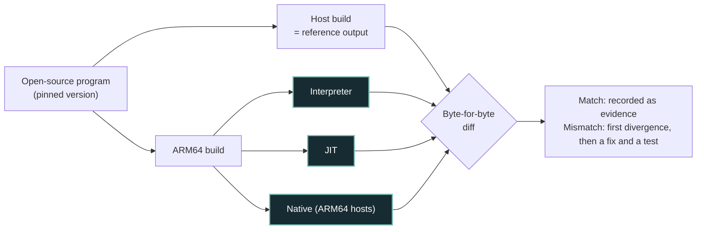

# Details

Everything that used to sit on the front page of the README: subsystem status, the proof method, the test harness, the full command reference, the roadmap, sources and legal notes. Start with the [README](../README.md); come here when you need the detail.

Contents: [Architecture](#architecture) · [Subsystem status](#subsystem-status) · [How the proof works](#how-the-proof-works) · [Switch regression corpus](#legacy-switch-regression-corpus) · [Test harness](#test-harness) · [Safe Rust boundary](#safe-rust-by-construction) · [Commands and setup](#commands-and-setup) · [Roadmap](#the-road-ahead) · [Sources and legal](#sources-and-porting-policy) · [Repository layout](#repository-layout)

---

## Architecture

The runtime loads an ARM64 program, models memory, system calls and services, and runs it on one of three engines. The Switch-era loader, kernel, GPU and audio models are still in the tree and tested. They are how the first programs got loaded, and they now serve as a regression corpus.


### The architecture at a glance

<!-- BEGIN GENERATED ARCHITECTURE: scripts/render_roadmap.py -->
Implemented code paths are not universal compatibility proof. Source links identify implementation, not certification.

| Layer | Current implementation | Important boundary | Source |
| :--- | :--- | :--- | :--- |
| **CPU execution** | AArch64 interpreter, cached/decoded/fused block paths (Tier 1–3), optional Tier-4 native JIT and AArch64-host native execution | Instruction coverage is partial; Tier-4 and native execution are separate from the Interpreter/Tier-3 headline oracle count. | [interpreter.rs](../src/cpu/interpreter.rs), [tier3_jit.rs](../src/cpu/tier3_jit.rs) |
| **Memory and kernel** | 4 KiB paged guest memory, access permissions, thread scheduling, synchronization and selected SVCs | Horizon-style subsets, not complete OS semantics, hardware timing or a security sandbox. | [memory.rs](../src/mmu/memory.rs), [scheduler.rs](../src/kernel/scheduler.rs) |
| **Services and loading** | Selected CMIF/TIPC service models; NRO/NSO and loose-directory loading; homebrew and synthetic execution paths | Incomplete service coverage; only unencrypted homebrew formats are loaded; parsing a file does not demonstrate execution. | [cmif.rs](../src/kernel/cmif.rs), [hipc.rs](../src/kernel/hipc.rs) |
| **Graphics and presentation** | Guest-frame capture, software rasterization, and experimental guest SASS execution through wgpu with render-target readback | Physical GPU execution and unchanged outside-frame oracles have separate qualification gates. | [host.rs](../src/gpu/ampere/host.rs), [render.rs](../src/gpu/ampere/render.rs) |
| **Audio and input** | Software audio mixing with CPAL host output; keyboard/gamepad mapping and selected HID service paths | Host device support varies by platform; external-program correctness needs case-specific tests. | [host.rs](../src/audio/host.rs), [audren.rs](../src/audio/audren.rs) |
| **Execution evidence** | Ounce-Verify records, first-frame oracles, artifact-integrity checks, corpus comparison, diagnosis, retries, bisection and resumable runs | Passing local unit tests or CI does not certify general compatibility, provenance or an independent rerun. | [ounce_verify.py](../tools/ounce_verify.py), [corpus_verify.py](../scripts/corpus_verify.py) |

<!-- END GENERATED ARCHITECTURE -->



## Subsystem status

Status reflects what the code does and what the tests exercise. "Modelled" means the behaviour is simulated in software, not measured against hardware.

| Subsystem | Status | Notes |
| :--- | :--- | :--- |
| AArch64 CPU | Implemented (subset) | Interpreter, Tier-1 block cache, Tier-2 decoded blocks, Tier-3 fused blocks, and optional Tier-4 native recompilation in `crates/ounce-recompiler` (`native-jit`). Guest writes to translated code stop the active block and invalidate stale translations; code-patch and differential tests cover this path. |
| Memory | Implemented | 4 KB-page MMU with intra-page boundary alignment and per-page permissions. No DRAM timing model. |
| Kernel (SVC) | Implemented (subset) | Threads, events, mutexes, memory and process queries needed by the test programs. |
| IPC | Implemented (subset) | CMIF and TIPC message formats. Services are synthetic. |
| Services | Modelled | `sm:`, `set:sys` (Drake T239 model, language, nickname), `am`, `vi`, `hid`, `fsp-srv` (directory enumeration, persistent save/sdmc partitions), `pl:u` (placeholder font data), `time:u` / `time:s` (nanosecond steady clock, UTC epoch timestamp), `nvdrv`, `ro:1`. |
| GPU | CPU execution; experimental host execution | Selected `MAXWELL_B` and `AMPERE_B` methods execute in the guest channel path. With `gpu-present` and `OUNCE_GPU_BACKEND=host`, supported guest SASS is translated to WGSL, submitted through a real host graphics API, and read back into the original guest surface. Adapter identity and completed readbacks are recorded; software adapters never count as hardware. [Scope and qualification](guest-host-gpu.md). |
| Shader translation | Partial | Maxwell/Ampere SASS lowers through SSA IR to WGSL; the experimental host path validates and submits supported shaders through wgpu. Indexed uniforms require actual guest binding sizes. Tegra encoding and shader-behavior coverage remain incomplete; the older SPIR-V emitter is a fixture. |
| Legacy pipeline fixture (`gpu/vulkan.rs`) | Bookkeeping only | Header checks and records; no device, driver calls or hardware presentation. Actual guest host execution lives in `gpu/ampere/host.rs`. |
| Host presentation (`gpu/present/`) | Implemented | Guest framebuffer and supported draw output presented through a host swapchain (`wgpu`: Metal on macOS, Vulkan on Linux/Windows; feature `gpu-present`), software window (`minifb`) or headless mode. A wgpu adapter may itself be software. |
| Upscaler (`gpu/upscaler.rs`) | Modelled | 2× bilinear interpolation with sharpening. **Not DLSS**; there is no neural network. |
| Audio | Implemented | Software 64-voice mixer; continuous non-blocking ring-buffer streaming from `audout:u` and `audren:u` to 48 kHz stereo host audio sink via `cpal` with polyphonic resampling, underrun tracking and latency metrics. |
| Input (`hid/`) | Implemented | Controller state filled from host keyboard and physical USB/Bluetooth gamepads via `gilrs` (analog stick threshold synthesis to D-pad bitmasks). |
| Formats | Implemented (parsing) | NSO0, NRO0, NPDM, RomFS, unencrypted loose directories. |
| Dynamic linking | Implemented (subset) | MOD0 `.dynamic` parsing; `R_AARCH64_RELATIVE`, `ABS64`, `GLOB_DAT`, `JUMP_SLOT`; imports resolved across modules in loose packages; `DT_REL`/`DT_RELA` tables; unresolved imports reported; `DT_GNU_HASH` symbol counts; TLS relocations (`TPREL64`, `DTPMOD64`, `DTPREL64`, `TLSDESC`) against a static TLS layout; `DT_INIT`/`INIT_ARRAY`/`FINI_ARRAY`/`DT_FINI` runner (opt-in, `OUNCE_RUN_INIT=1`). `PT_TLS` templates (`.tdata` copied, `.tbss` zeroed, `p_align` honoured) when supplied from an ELF; each `svcCreateThread` thread gets its own TLS area and `TPIDR_EL0`. Limits: NSO/NRO carry no `PT_TLS`, so for them TLS block sizes come from `STT_TLS` symbols, alignment is assumed 16, and blocks start zeroed. Guest SVCs inside initialisers are not serviced. |

**Known limitations**

- Timing and MIPS figures are host measurements of small synthetic programs. They are not comparable to hardware and are not pass/fail criteria.
- Behaviour not exercised by an outside program's pixel oracle is tested at best, not proven.

---

## How the proof works

Three rules make the [headline number](#legacy-switch-regression-corpus) hard to fake. Each links to the code or CI run that enforces it.

**1. Register the checks before execution.** Read the program at its pinned upstream revision and specify what its first queued frame should show. [The oracle generator](../tools/corpus_oracle.py) computes the expected hashes or pixel probes from [those specs](../tests/corpus/oracles.json), and CI recomputes them. The [method notes](corpus-oracles.md) record the provenance of deko-basic's previously observed frame hashes.

**2. Check the registered pixels.** Full-frame oracles compare an RGBA8 FNV-1a 64 hash. Probe oracles compare named pixels when only parts of a frame are predictable from source. A fault, unhandled SVC, timeout or early exit fails the oracle even if a frame was queued.

**3. Two engines must agree bit for bit.** Every oracle runs twice: on the reference interpreter and on the Tier-3 JIT (`Tier3JitEngine`, which fuses hot decoded blocks into traces in safe Rust; it does not emit native code). A program counts only if both engines match the oracle *and* their queued frames are identical; otherwise the runner records "interpreter and Tier-3 frames differ". The canonical corpus headline counts qualifying outside programs using these two engines only. Native execution and the optional Tier-4 recompiler are evaluated separately; neither contributes to this interpreter/Tier-3 headline count.

**Where the number comes from.** CI writes one [`ounce-verify/v0`](verify/README.md) record per program and engine, builds a canonical report from them, and derives the count from it ([`scripts/corpus_verify.py`](../scripts/corpus_verify.py)). The README headline and the oracle badge are never edited by hand: CI fails if either disagrees with the report. Canonical corpus evidence: [Ounce-Verify reporting](verify/README.md) and [current external-corpus runs](https://github.com/hffgzktbcc-blip/ounce-core/actions/workflows/external-corpus.yml). The CI-controlled headline is <!-- corpus-headline -->50/50<!-- /corpus-headline -->; inspect the matching run artifact for underlying records.

| Evidence | Status | Source |
| :--- | :--- | :--- |
| First-frame oracles (interpreter and Tier-3) | **<!-- corpus-headline -->50/50<!-- /corpus-headline --> pass** | [current external-corpus runs](https://github.com/hffgzktbcc-blip/ounce-core/actions/workflows/external-corpus.yml) · [oracles.json](../tests/corpus/oracles.json) · [method](corpus-oracles.md) |
| CI on Linux, macOS and Windows | [](https://github.com/hffgzktbcc-blip/ounce-core/actions/workflows/ci.yml?query=branch%3Amain) | Each OS runs the unit tests, the 25-stage harness, `gpu-present` and Tier-4 jobs (native execution runs on AArch64 macOS and Linux); see [current main-branch CI runs](https://github.com/hffgzktbcc-blip/ounce-core/actions/workflows/ci.yml?query=branch%3Amain) for up-to-date results across the matrix |
| Safe Rust in `src` | `#![forbid(unsafe_code)]` | [`src/main.rs`](../src/main.rs), enforced by the compiler on every CI build |

The oracles run on Linux only (the corpus is built in the devkitA64 Docker image). The three-OS CI jobs run tests written for this repository; they guard the code but are not proof that outside programs work.

---

## Legacy Switch regression corpus

**<!-- corpus-headline -->50/50<!-- /corpus-headline --> outside homebrew programs pass their registered first-frame oracle.** These are programs we did not write, built unchanged from pinned upstream commits ([provenance](PROVENANCE.md)). Interpreter and Tier-3 both pass the registered pixel checks. The oracle manifest distinguishes whole-frame hashes from named pixel probes ([method](corpus-oracles.md)). The count comes from the [Ounce-Verify](verify/README.md) canonical report, with [current external-corpus runs](https://github.com/hffgzktbcc-blip/ounce-core/actions/workflows/external-corpus.yml) containing the underlying artifacts; CI fails if this README disagrees with the report or with the committed [snapshot](../tests/corpus/oracle-results.json). The committed snapshot comes from a fresh local [canonical report](verify/corpus-c47fa14/canonical-corpus.json) at core commit `c47fa14` (macOS arm64 host, Lima Docker; not an independent rerun). Failures are the to-do list.

| Selected program | Source | Oracle | Result (both engines) |
| :--- | :--- | :--- | :--- |
| `printing-hello-world` | [switchbrew/switch-examples](https://github.com/switchbrew/switch-examples) | pixel-exact | pass |
| `vt52-demo` | [switchbrew/switch-examples](https://github.com/switchbrew/switch-examples) | pixel-exact | pass |
| `read-controls` | [switchbrew/switch-examples](https://github.com/switchbrew/switch-examples) | pixel-exact | pass |
| `touch-screen` | [switchbrew/switch-examples](https://github.com/switchbrew/switch-examples) | pixel-exact | pass |
| `sixaxis` | [switchbrew/switch-examples](https://github.com/switchbrew/switch-examples) | pixel-exact | pass |
| `audren-simple` | [switchbrew/switch-examples](https://github.com/switchbrew/switch-examples) | pixel-exact | pass |
| `get-system-language` | [switchbrew/switch-examples](https://github.com/switchbrew/switch-examples) | pixel-exact | pass |
| `barrier` | [switchbrew/switch-examples](https://github.com/switchbrew/switch-examples) | pixel-exact | pass |
| `user-events` | [switchbrew/switch-examples](https://github.com/switchbrew/switch-examples) | pixel-exact | pass |
| `user-timers` | [switchbrew/switch-examples](https://github.com/switchbrew/switch-examples) | pixel-exact | pass |
| `deko-console` | [switchbrew/switch-examples](https://github.com/switchbrew/switch-examples) | pixel-exact | pass |
| `deko-examples-menu` | [switchbrew/switch-examples](https://github.com/switchbrew/switch-examples) | pixel-exact | pass |
| `sdl2-simple` | [switchbrew/switch-examples](https://github.com/switchbrew/switch-examples) | pixel-exact | pass |
| `raufang-hello-cpp` | [Raufang/switch-hello-world](https://github.com/Raufang/switch-hello-world) | pixel-exact | pass |
| `nx-hbmenu` | [switchbrew/nx-hbmenu](https://github.com/switchbrew/nx-hbmenu) | pixel probes | pass |
| `hybrid-app` | [fincs/hybrid_app](https://github.com/fincs/hybrid_app) | pixel probes | pass |
| `simplegfx` | [switchbrew/switch-examples](https://github.com/switchbrew/switch-examples) | pixel-exact | pass |
| `deko-basic` | [switchbrew/switch-examples](https://github.com/switchbrew/switch-examples) | observed-hash oracle (regression check, not source-derived) | pass |
| `startup` | [switchbrew/switch-examples](https://github.com/switchbrew/switch-examples) | pixel-exact | pass |
| `romfs` | [switchbrew/switch-examples](https://github.com/switchbrew/switch-examples) | pixel-exact | pass |

The table shows selected examples, not the entire registered corpus. Every oracle run is in the [External corpus workflow](https://github.com/hffgzktbcc-blip/ounce-core/actions/workflows/external-corpus.yml). Reproduction guides: [simplegfx](REPRODUCE_SIMPLEGFX.md), [deko_basic](REPRODUCE_DEKO_BASIC.md), [romfs](REPRODUCE_ROMFS.md).

**Tested, not proven:** the 25-stage harness, the unit tests and the 9 cross-platform [CI](https://github.com/hffgzktbcc-blip/ounce-core/actions/workflows/ci.yml) jobs run programs and inputs written for this repository. They guard the code against regressions. They do not show that any outside program works.

None of this establishes general homebrew, Switch 2 or commercial-software support.

## Test harness

```bash
cargo test --release
cargo run --release -- test
```

The harness currently reports 36 checks across 25 stages. It runs synthetic AArch64 programs written for this repository through the CPU, kernel and service models. It is not an independently authored homebrew compatibility suite. Guest exit codes and explicit subsystem output checks gate success; service errors, a wrong loop checksum or a wrong decoded texel fail the run. Host timings are informational only. Passing this harness does not establish compatibility with commercial software or general homebrew compatibility.

CI coverage is feature-specific: the default job runs unit tests and the 25-stage harness; `gpu-present` builds and runs unit tests but does not run that harness; `native-jit` tests the recompiler crate, builds the feature, runs the Tier-4 host self-test and feature-enabled unit tests, but does not run the 25-stage harness. These configured checks describe CI coverage, not the result of the latest run. Test totals are omitted because they can change between revisions.

| Stage | Subsystem | What it checks | Exit |
| :---: | :--- | :--- | :---: |
| 01 | AArch64 ALU & branching | Fibonacci `N=10` through the block cache | `55` |
| 02 | Debug SVC | `svcOutputDebugString` with a guest string | — |
| 03 | Calling convention | Stack frame, `BL` and `RET` | `42` |
| 04 | CMIF IPC & vector math | `sm:` lookup of `nvdrv`, IEEE-754 `FADD` | `D0 = 42.0` |
| 05 | RomFS & PCM audio | Reads `romfs:/title.txt`, queues audio to `audout:u` | — |
| 06 | SASS decode & threads | SASS-subset decode, thread spawn | — |
| 07 | Image boot & rasterizer | Boots a raw AArch64 image, futex arbitration, textured triangle | — |
| 08 | crt0 & depth | `svcGetInfo`, direct-chained JIT, Z-buffer occlusion | — |
| 09 | NEON & upscaler | 128-bit vector arithmetic, 2× upscaler, save sync | — |
| 10 | FS query test | BTI landing pad, process/thread queries, challenge response | — |
| 11 | Dynamic linker | `RO` NSO0 module over TIPC, `TESTRPLY` reply | — |
| 12 | Thread-affinity wrapper | `BL` into a leaf that returns `0xFF`, then `AND X0, X0, #7` | `0x07` |
| 13 | Timing & events | Synthetic event init, try-wait and tick frequency | `0x124F801` (19,200,001) |
| 14 | NSO0 boot | Synthetic NSO0 module loaded through `BootLoader` | — |
| 15 | NVN command buffer | `SVC #0x105` (research range) submission, RomFS mount | — |
| 16 | audren & Vulkan model | Memory pools, voice mixing, SPIR-V module construction | — |
| 17 | Service handshake | `set:sys`, `am:appletOE`, `vi:m`, `hid`, `fsp-srv` | `0x777` |
| 18 | ro:1 & texture pools | `LoadNro`, BC7 descriptor binding | `0x888` |
| 19 | SDK-style HLE runtime | Standard allocator, `SleepThread`, `nn::fs::OpenFile` | `0x999` |
| 20 | Tier-3 / optional Tier-4 | Hot-loop benchmark; select with `--cpu=tier3|tier4` (`native-jit` required for Tier-4). Host MIPS is informational, not gated. | `0xAAA` |
| 21 | Loose packages | NPDM parse, multi-module link, loose RomFS | `0xBBB` |
| 22 | Shared font & clock | `pl:u` placeholder mapping, `time:u`, ASTC 4×4 | `0xCCC` |
| 23 | Applet & GPU model | `IApplicationFunctions`, `ISelfController`, ASTC 8×8 | `0xDDD` |
| 24 | Synthetic opcode translation & NVN ring | `HADD2`/`HMUL2`/`HFMA2` decoding and translation structure (not packed-half arithmetic execution), command count and buffer cycling | `0xEEE` |
| 25 | Tensor core MMA | Warp-level FP16 matrix multiply-accumulate (`HMMA.1688`, `HMMA.16816`) with FP32 accumulate, checked against IEEE binary16 vectors | `0xEEE` |

---

## Safe Rust by construction

The runtime in `src/` is one crate with `#![forbid(unsafe_code)]` at its root ([`src/main.rs`](../src/main.rs)), so the compiler rejects any `unsafe` block there; `forbid` cannot be overridden further down. The CPU engines, kernel and service models, memory and GPU decoding in `src` are all safe Rust.

`unsafe` is allowed only where it cannot be avoided, in a separate crate under `crates/` with its boundary named:

- **Native code generation.** [`crates/ounce-recompiler`](../crates/ounce-recompiler/src/lib.rs), the optional Tier-4 recompiler behind `native-jit`, denies `unsafe` crate-wide and allows it only in its `exec` module (W^X executable memory and calls into generated code).
- **Native execution, ported from MIT code.** [`crates/ounce-nce`](../crates/ounce-nce/src/lib.rs), behind the `nce` feature, runs homebrew ARM64 code directly on an AArch64 host after rewriting its `svc`, `TPIDR_EL0` and timer instructions into trampolines (rules ported from nxnative, MIT; see [`THIRD_PARTY.md`](../THIRD_PARTY.md)). The rewriter is safe Rust; `unsafe` is denied crate-wide and allowed only in `arena` (guest memory at guest address == host address) and `exec` (entering guest code, trampoline exits, fault signals).

Any other code, ported or new, that genuinely needs `unsafe` goes into an isolated crate with focused tests and review of that boundary ([CONTRIBUTING](../CONTRIBUTING.md)). Ported code that can be written safely goes into `src` as safe Rust.

---

## Commands and setup

Install, build and first-run steps are in the [README](../README.md#run-it-locally). This is the full reference.

### Prerequisites

- Rust 1.85 or newer (edition 2024).
- Host: `aarch64` or `x86_64`, Linux, macOS or Windows.
- Prebuilt Linux binaries dynamically link to the system ALSA and udev libraries. On Debian/Ubuntu: `sudo apt install libasound2 libudev1`. On Fedora: `sudo dnf install alsa-lib systemd-libs`. On Arch: `sudo pacman -S alsa-lib systemd-libs`. Building from source also needs the development headers (`libasound2-dev libudev-dev` on Debian/Ubuntu).
- GPU presentation (optional): build with `--features gpu-present`. macOS uses Metal and needs nothing extra. Windows uses Vulkan or DX12 from the installed GPU driver. Linux needs a Vulkan driver plus `libvulkan1` and `libxkbcommon-x11-0` on Debian/Ubuntu (`vulkan-loader libxkbcommon-x11` on Fedora, `vulkan-icd-loader libxkbcommon-x11` on Arch); `mesa-vulkan-drivers` gives a software Vulkan driver for machines without a GPU. If the GPU path cannot start, the runtime falls back to the software window and then to headless.

### Commands

```bash
cargo run --release -- info                      # Show modelled hardware and engine status
cargo run --release -- test                      # Run the 25-stage harness
cargo run --release -- run tests/fixtures/nro/hello/hello.nro fixture  # Boot the libnx homebrew fixture (prints result=0x00000EEE)
cargo run --release -- inspect ./my_program     # Inspect a loose exefs/ + romfs/ directory
cargo run --release -- run ./my_program --gui   # Boot a loose directory in a window
cargo run --release -- demo-dir ./demo --gui     # Generate a synthetic loose package and boot it
cargo run --release -- play                      # Keyboard-driven controller and graphics demo
cargo run --release -- 3d 120                    # Software rasterizer benchmark
cargo run --release --features gpu-present -- gfx --present=gpu   # Present through the GPU swapchain
cargo run --release -- gfx 60 --present=headless # No window; OUNCE_DUMP_FRAMES=<dir> writes PPM frames
cargo run --release --features native-jit -- jit-selftest # Check whether this host can execute Tier-4 code
cargo run --release --features native-jit -- test --cpu=tier4 # Run Tier-4 for the Stage 20 benchmark
```

`--present=auto|gpu|minifb|headless` (or `OUNCE_PRESENT`) picks the presentation backend; `auto` tries the GPU first when the feature is compiled in. `WGPU_BACKEND` (`vulkan`, `metal`, `dx12`, `gl`) and `WGPU_ADAPTER_NAME` select the GPU, and `OUNCE_VSYNC=0` disables vsync. `--cpu=tier3|tier4` (or `OUNCE_CPU`) selects the block engine for the Stage 20 benchmark and for `run`/`run-nro` (with no flag, `run-nro` executes one instruction at a time in the interpreter). Tier-4 requires `--features native-jit`; the native engine is not currently used for general `run` workloads.

### Native Mac launcher (local preview)

With Rust and Xcode command-line tools installed, build and install locally:

```sh
scripts/build_macos_app.sh "$HOME/Applications/Ounce Core.app"
```

Open **Ounce Core.app**. It opens one window, the workbench. Drop a homebrew `.nro` on the window or the Dock
icon, or choose **File > Check a Program…**. Static AArch64 Linux ELF programs run in the CLI with `ounce-core run-elf <file>`.

- **File > Open Saved Results…** opens a saved `result.json` or Ounce-Verify report in a read-only window. It runs nothing.
- **Help > Report a Problem…** opens the same prefilled issue form as the page's Report This Problem (program, engine, hash, headline) (your home folder is replaced by `~`). Nothing is sent until you submit the form.
- **View > Advanced** keeps the older launcher functions: **Run in a Window…** and **Graphics Demo** (the runtime's own
  graphics window), **Run Settings…** (engine `tier3`, `tier4` or `native`, and an instruction budget; blank = 50
  million), **SD Card Folder…**, **Show Last Session Log** and **Stop Running Program**. Comparing a known test program
  with its recorded reference is an option on the page (Advanced > Compare with the recorded reference). A failed run
  shows a plain-language diagnosis read from the runtime's own log, with **Report a Problem…**.
- The bundled runtime is built with the `nce` and `native-jit` features, so `tier4` and `native` work on an Apple
  Silicon Mac; elsewhere the runtime falls back to `tier3`, and the app says so instead of reporting a pass.
  Logs and the default SD folder live under `~/Library/Application Support/Ounce Core/`.

Details: [MAC_APP.md](MAC_APP.md).

The app is locally ad-hoc signed, not a notarized distribution release, and no
prebuilt download is offered. Supported programs remain those backed by the compatibility
oracles; this launcher does not expand that claim. Details, tests and untested GUI areas:
[docs/MAC_APP.md](MAC_APP.md).

### Diagnosis and reporting


When an execution stops, fails, or produces unexpected output:

- **Inspect error messages:** An unhandled SVC, unimplemented opcode, or memory fault prints the program counter (PC), opcode word, and register snapshot. If a loop exceeds the instruction budget, increase it with `OUNCE_NRO_BUDGET=100000000`.
- **Pinpoint divergence against real hardware:** On an AArch64 host, run `diverge` to compare execution against the host CPU and locate the exact first instruction where the emulator and hardware disagree:
  ```bash
  target/release/ounce-core diverge path/to/program.nro
  ```
- **Package a reproducible failure dossier:** Use the diagnosis CLI to generate a portable dossier with `diagnosis.json`, `comparison.json`, and `REPLAY.md` without private paths or credentials:
  ```bash
  python3 scripts/diagnosis_cli.py example --output ./my-diagnosis
  ```
  The resulting dossier packages exact inputs, revisions, and replay instructions. See [docs/DIAGNOSIS_CLI.md](DIAGNOSIS_CLI.md) and [docs/FAILURE_TO_REPRODUCTION.md](FAILURE_TO_REPRODUCTION.md).

#### Reporting findings

- **Report emulation bugs:** If a program behaves differently in Ounce-Core than on real ARM64 hardware or in a reference build, open an issue using the [Emulation bug template](https://github.com/hffgzktbcc-blip/ounce-core/issues/new?template=emulation_bug.yml). Provide:
  1. Pinned program name, commit or version, and build command.
  2. Engine used (`--cpu=tier3`, `--cpu=tier4`, or `--cpu=native`).
  3. Expected reference output from real hardware or host build.
  4. Observed output, including the first differing line or `[VM Error]` line.
  5. Exact command line, host OS/architecture, and Git commit (`git rev-parse HEAD`).
- **Submit differential test runs:** Run `python3 scripts/verify_differential.py --json my-results.json` on an ARM64 computer and report your findings on [Issue #248](https://github.com/hffgzktbcc-blip/ounce-core/issues/248) using the [External Test Report Template](community/EXTERNAL_TEST_REPORT.md).
- **Propose a new test program:** Suggest an open-source library or test case using the [Program request template](https://github.com/hffgzktbcc-blip/ounce-core/issues/new?template=program_request.yml).
- **Responsible reporting guardrails:** Do not submit or link retail keys, copyrighted firmware, commercial game dumps, or proprietary assets. Only open-source or synthetic test material is accepted.

Use **self-authored, licensed or synthetic material** only. Do not supply retail keys, firmware or commercial game dumps.

---

## The road ahead

*Deliver one reproducible developer result at a time; implementation and historical benchmarks are supporting evidence.*

<!-- BEGIN GENERATED ROADMAP: scripts/render_roadmap.py -->
This section is rendered from [the milestone registry](roadmap/milestones.json). Research stages require reviewed evidence; PR status is observational only. A green badge or merged PR is not proof of compatibility.

| Live check | Current GitHub status | Evidence boundary |
| :--- | :--- | :--- |
| CI | [](https://github.com/hffgzktbcc-blip/ounce-core/actions/workflows/ci.yml?query=branch%3Amain) | Configured test jobs only |
| External corpus | [](https://github.com/hffgzktbcc-blip/ounce-core/actions/workflows/external-corpus.yml?query=branch%3Amain) | Oracle pipeline health, not a new pass by itself |

| Research track | Reviewed stage | Supporting evidence | Next proof gate |
| :--- | :--- | :--- | :--- |
| Static Linux ARM64 programs | experimental | [Six freestanding fixtures plus 18 real programs run as static musl ELFs (LZ4, xxHash, cJSON and zlib also on macOS and Windows); wasm3 does not run yet](verify/linux-elf/README.md) | Fix wasm3 as an ELF (#366); expand Linux library coverage from observed needs; qualify portable execution recording |
| Differential verification against real ARM64 | measured | [Seeded single-instruction hardware fuzzing and three-engine comparisons; bounded results retained](verify/insn-fuzzer/README.md) | ARM64 fuzzer CI is qualified (hosted Apple Silicon job passed 2026-11-08); next expand per-family and sequence coverage (vision step 2) |
| Agent workflow | measured | [Handoff snapshots, expiring claims and shared journal; used by four agents in parallel](AGENT_HUB.md) | Keep the tool simple; fix friction as agents report it |
| Failure to reproduction | measured | [R1, R2 and R4 done: retained SDL2/audio diagnosis (failure-to-reproduction walkthrough, one externally grounded developer issue, audio-case result) and one hardware-observed instruction mismatch with exact register snapshots](INSTRUCTION_DIAGNOSIS.md) | The measured vector-multiply discrepancy is repaired; the scalar-FP sibling is open as #362; arbitrary-program first divergence remains unestablished |
| Usable community tool | measured | [R3 and R5 done: standalone diagnosis toolkit 0.2.0 installable and published with checksums and acceptance evidence (R1–R5 are all complete)](releases/diagnosis-0.2.0-readiness.md) | No outside feedback received yet; collect it. Runtime distribution has separate provenance dependencies |
| Switch regression corpus (legacy) | measured | [Canonical first-frame oracle corpus](verify/README.md) — **<!-- corpus-headline -->50/50<!-- /corpus-headline --> passes** (CI-certified) | Keep passing in CI; no expansion unless a program reproduces a concrete CPU bug |
| Switch 2 research (archived) | experimental | [Limited SDK-path observation](verify/README.md) | No further work; kept as a record. Not part of the product direction (see docs/VISION.md) |

**Live navigation:** [open PRs](https://github.com/hffgzktbcc-blip/ounce-core/pulls?q=is%3Apr+is%3Aopen) · [open issues](https://github.com/hffgzktbcc-blip/ounce-core/issues?q=is%3Aissue+is%3Aopen) · [Actions](https://github.com/hffgzktbcc-blip/ounce-core/actions) · [verification method](verify/README.md) · [PLAN.md](../PLAN.md).

No general homebrew, commercial-game or Switch 2 compatibility claim is implied. The corpus count is independently guarded by [the canonical headline checker](../scripts/corpus_verify.py).
<!-- END GENERATED ROADMAP -->

---

## Sources and porting policy

ounce-core is **not a clean-room project**. Besides public specifications (Arm ARM, Mesa NAK, Nouveau/envytools), homebrew library source (libnx, deko3d) and observation of outside homebrew, it may read and port MIT-licensed emulator code from **nxnative** and **Ryujinx** to Rust, keeping their notices in [`THIRD_PARTY.md`](../THIRD_PARTY.md) and recording each port in [`docs/PROVENANCE.md`](PROVENANCE.md). GPL emulator code, Nintendo SDK code, firmware, keys, leaked material and retail games are never used. Details and legal guardrails: [`docs/CLEAN_ROOM.md`](CLEAN_ROOM.md).

---

## Responsible research and legal

> [!IMPORTANT]
> Ounce-Core is **unaffiliated** with Nintendo, NVIDIA or their affiliates. Nintendo Switch, Switch 2, NVIDIA, Tegra, Horizon and related names are used descriptively and remain the respective owners' trademarks. This project runs open-source homebrew; it is not a commercial-game product.

- **Homebrew and synthetic material only.** The runtime loads unencrypted homebrew formats; it has no key handling and no encrypted-container support.
- **Distribution scope:** runtime archives exclude NRO fixtures and SDK files; the standalone Python toolkit uses its own reviewed source snapshot. [Current licensing disposition](LICENSE_DISPOSITION.md) records the exact notice, fixture and historical boundaries.
- **Test fixtures:** all eleven committed NROs have byte-identical rebuild evidence and registered inputs. Source/component permission review is separate from build identity.
- **Licensing:** project source is [MIT-licensed](../LICENSE), with [third-party notices](../THIRD_PARTY.md). This does not certify the status of every historical or binary component.

Read [the provenance register](PROVENANCE.md), [sources and legal guardrails](CLEAN_ROOM.md), [current licensing disposition](LICENSE_DISPOSITION.md), and [contribution guidelines](../CONTRIBUTING.md) before contributing.

<details>
<summary><strong>Full legal notice, security advisory and current known issues</strong></summary>

### Full legal notice

**What this repository does not contain**

- No firmware, system archives, or code or data derived from them.
- No encryption keys and no key handling or decryption code. The loader accepts only unencrypted homebrew formats (NRO, NSO, loose directories). The `.gitignore` excludes key files and a CI check fails if key-parsing or container-decryption code is added.
- No retail game content, ROMs, or dumps. Tests include generated synthetic programs and checked-in homebrew NRO fixtures. The `hello` fixture build links libnx and uses the devkitA64/newlib toolchain; see [`tests/fixtures/nro/hello/README.md`](../tests/fixtures/nro/hello/README.md). Fixture identities, rebuilds and selected linked inputs are recorded; source/component permission review remains separate; see [`docs/PROVENANCE.md`](PROVENANCE.md) and [`THIRD_PARTY.md`](../THIRD_PARTY.md).
- Earlier revisions contained firmware-derived and third-party-derived byte sequences; they were removed from the current tree but remain in git history. See *Known Issues*.

**Trademarks.** "Nintendo", "Nintendo Switch", "Switch 2", "NVIDIA", "Tegra", "Horizon" and related names are trademarks of their respective owners. This project is not affiliated with, endorsed by, or sponsored by any of them. Names appear only to describe the hardware and ABI being modelled.

**No warranty; not legal advice.** The software is provided as is. Anyone using, modifying or distributing it is responsible for complying with the copyright, anti-circumvention and other laws that apply where they are. Consult a lawyer before any use beyond private research.

**License information.** The repository includes an MIT license ([`LICENSE`](../LICENSE)) and third-party material notes ([`THIRD_PARTY.md`](../THIRD_PARTY.md)). These documents do not determine the licensing status of historical commits or every component in the checked-in binaries.

### Security advisory

> [!WARNING]
> Third parties may distribute executables labelled "ounce-core" that contain malware. The only source of this project is the repository above. Build from source with the standard Rust toolchain.

### Known issues

- **Linux ELF runner.** wasm3 built as a static musl ELF fails to load its first module under `run-elf` (an allocator request of about 1 TiB is refused); cause not yet understood ([#366](https://github.com/hffgzktbcc-blip/ounce-core/issues/366)).
- **Floating point.** The interpreter and Tier-3 now raise the FPSR exception flags (IOC, DZC, OFC, UFC, IXC, IDC) for scalar and vector arithmetic, conversions, FRINT*, compares and FMAX/FMIN (#373). Tier-4 compiled FP cannot raise them: once a program touches FPSR, Tier-4 hands FP arithmetic and compares to the interpreter, and flags raised before that first access are lost ([details](verify/fp-edge/README.md)). FPCR trap enables and half-precision arithmetic are not modelled. The FPCR rounding, flush and default-NaN fix (#363) matched Linux Arm and Apple M1 hardware on the fp-edge corpus: 0 mismatches at all nine FPCR values on all three engines ([CI run](https://github.com/hffgzktbcc-blip/ounce-core/actions/runs/42971358680)); that corpus is bounded.
- **Historical scope.** The later object-level inventory narrows the firmware-labelled candidate objects to retained PR #1, with no exact matches in current source or the inspected releases. A separate historical 72-byte program has no recorded redistribution grant. See [docs/PROVENANCE.md](PROVENANCE.md); no global purge is claimed.
- **Notice and rights status.** Completed controls, remaining upstream qualifications and release-specific requirements are maintained in [one disposition](LICENSE_DISPOSITION.md). An identity check or notice collection does not supply an absent redistribution grant.

</details>

---

## About the maintainer

Ounce-Core is developed from an interdisciplinary background spanning **psychology, education and research**. My academic training includes Clinical, Counselling and Industrial Psychology, honours-level study in Clinical and Research Psychology, master's-programme study in Research Psychology, and a Postgraduate Certificate in Education (PGCE).

That background shapes the project's emphasis on careful experimentation, reproducible evidence and making complex systems understandable. It informs the approach—not a claim of formal computer science credentials.

## Repository layout

```
ounce-core/
├── .github/workflows/ # Cross-platform CI
├── assets/            # README artwork and other assets
├── crates/
│   └── ounce-recompiler/ # Optional Tier-4 native code and executable-memory boundary
├── docs/design/       # Architecture and implementation notes
├── src/               # Runtime, CPU, GPU, kernel, loader and host integrations
├── tests/fixtures/nro/ # Checked-in homebrew integration fixtures
├── AGENTS.md
├── Cargo.lock
├── Cargo.toml
├── CONTRIBUTING.md
├── LICENSE
└── README.md
```
