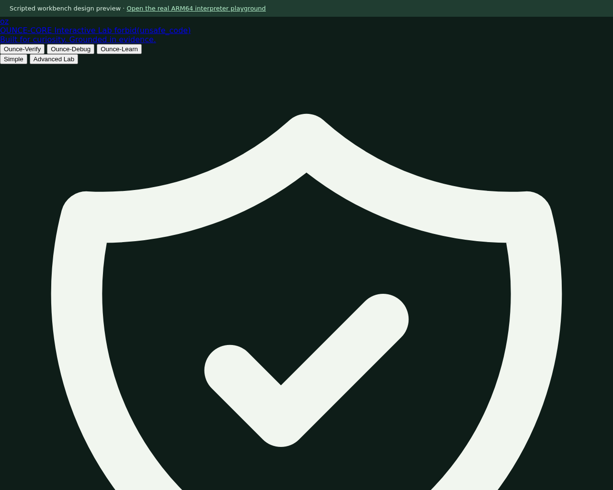

# Interactive lab (`site/lab.html`): design preview

A browser workbench that shows how Ounce-Core could present ARM64 verification to people who do not
read assembly or use a command line. **It is a design preview.** The page's own banner says
"Scripted workbench design preview": most of what it shows is scripted values, not the real engines.
For real in-browser ARM64 execution use the [WebAssembly playground](PLAYGROUND.md).

Run it locally with `./scripts/open_lab.sh` or `cargo run --release -- ui` (also `-- lab`), or
`python3 -m http.server 8080 --directory site` and open `http://localhost:8080/lab.html`. The published
copy is at <https://hffgzktbcc-blip.github.io/ounce-core/lab.html>.

The screenshot is a headless Chromium render of the page as committed. It shows the layout, not
verified results.

## What is real

- **File intake, in your browser only.** Dropping a file computes its SHA-256 with the browser's Web
  Crypto (`crypto.subtle.digest`) and reads the header in JavaScript: ELF machine (`0xB7` is
  AArch64, other values are reported as other architectures), the Homebrew NRO magic, and
  container magics for XCI/HFS0. Nothing is uploaded. The page's messages about support (for
  example "Supported by run-elf" or "Compatible with 50/50 First-Frame") come from the header
  check alone. They do not mean the file runs, and the 50/50 oracles cover the repository's
  own corpus, not an arbitrary NRO.
- **Layout and wording.** The Simple / Advanced Lab switch, the maturity labels
  (`research-only`, `bounded-verified`, `independently reproduced`, `publicly supported`) and the
  no-keys, no-firmware, no-retail-content notice are fixed text on the page.

## What is scripted (not executed)

- **The verification matrix and pass/fail cards.** They do not run the interpreter, Tier-3 or native
  engine, and they do not compare against hardware. For real comparisons use
  `docs/REPRODUCE.md` and `python3 scripts/verify_differential.py`; the results that are retained
  are listed in [LIMITS.md](LIMITS.md).
- **The divergence explorer.** It replays hand-written descriptions of historical bugs (such as the
  `PRFM` register overwrite and the `FMLA` sign error). It does not locate a divergence in
  anything you load. Arbitrary-program first divergence is not established.
- **The step-through and register views.** They step a fixed, hand-written sample program
  (it starts with `mov x0, #100`); register and flag values are scripted. The real instruction
  stepper is in the playground.

Nothing on this page is evidence for a compatibility, performance or correctness claim.

## Relationship with other frontends

| Frontend | What it does | Where |
| :--- | :--- | :--- |
| Interactive lab | Design preview plus local file inspection | [`site/lab.html`](../site/lab.html) |
| WebAssembly playground | Real AArch64 instruction stepping, compiled from the safe-Rust core | [`crates/ounce-learn`](../crates/ounce-learn/), [PLAYGROUND.md](PLAYGROUND.md) |
| Native Mac app | Runs `.nro` files through the runtime on Apple Silicon | [`tools/macos-launcher`](../tools/macos-launcher/), [MAC_APP.md](MAC_APP.md) |
| CLI | The runtime and verification commands | [`src/main.rs`](../src/main.rs) |

The page loads its Tailwind script from `gstatic.com` at view time, so it needs network access to
render as designed.
